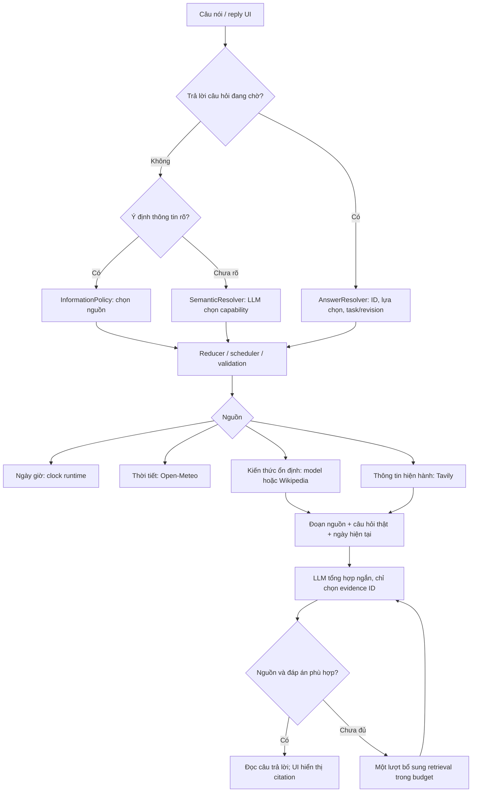

# Thời tiết và chọn nguồn thông tin — 14/10/2026

## Lỗi trong log

Đọc `handbook_turns` của `data/vivi_rag.sqlite3`, các lượt 1309–1325:

- 1309: câu hỏi ngày hệ thống bị nhận thành tên điểm đến khi đang chờ tên. 1312: model lại nói không đọc được ngày từ xe.
- 1314–1316: Phú Quốc trả ba nhãn giống nhau; “Cái đầu tiên” thành tên geocode, còn “đảo Phú Quốc” không bỏ tiền tố trước khi tìm.
- 1320/1322: chức danh đang được ai giữ lại dùng Wikipedia. Query bỏ chữ “Ai đang”, nên câu tổng hợp có citation vẫn chỉ là định nghĩa chức danh.
- 1323: guard đổi proposal `knowledge.lookup` thành `conversation.respond`, cho phép nói số liệu hành chính từ trí nhớ model không kiểm chứng.
- 1324: gửi cả câu “Hà Nội rộng bao nhiêu km2?” vào tìm Wikipedia dẫn tới các trang của thực thể khác, rồi model từ chối tổng hợp.

Vấn đề nằm ở cả quyết định nguồn, query/goal bị mất, retrieval thiếu nội dung và kiểm tra đáp án; không chỉ là model viết câu chưa hay.

## Kiến trúc đang chạy

Vòng bổ sung chỉ chạy một lần bằng code, không phải agent loop vô hạn. Nếu vẫn thiếu bằng chứng thì báo chưa xác minh và giữ nguồn. Xe tiếp tục có luồng riêng: handbook RAG cho hướng dẫn/thông số, vehicle API cho trạng thái thực tế; thông tin internet không cấp quyền thực thi xe.

### Khi nào dùng kiến thức sẵn có?

Trọng số LLM chứa kiến thức học được, không tự cập nhật khi chạy và không chứng minh được rằng một câu trả lời còn đúng. Không có một phép kiểm tra chắc chắn “model biết/không biết”. Runtime dựa vào loại thông tin, yêu cầu thời gian và yêu cầu nguồn:

| Câu hỏi | Nguồn / hành vi |
| --- | --- |
| Chào hỏi, tâm sự, “Vì sao có cầu vồng?” | `conversation.respond`: kiến thức ổn định của model; model có thể chọn tra cứu khi cần kiểm chứng |
| Lịch sử/văn hóa hoặc muốn nguồn bách khoa | `knowledge.lookup`: Wikipedia; bổ sung web nếu đoạn đầu không trả lời được |
| Ai đang giữ chức vụ, tỉnh/thành, địa giới, dân số/diện tích, giá, lịch hoạt động, tin/sự kiện, gợi ý du lịch | `web.search`: nguồn hiện hành; không quay về trí nhớ model để đoán |
| Thời tiết | API dự báo, không dùng kiến thức model để đoán nhiệt độ/mưa |
| Ngày/thứ/năm/giờ hiện tại | Clock runtime theo múi giờ cấu hình; không cần model hay đọc xe |

`information/policy.py` là chính sách cho các dạng câu rõ. Với cách nói chưa nhận diện được, SemanticResolver vẫn dùng LLM, contracts và guard. Rules này không chứng minh mọi câu tự nhiên đều được phân loại đúng; cần tiếp tục đánh giá các cách nói mới. Một lời tâm sự có “hôm nay” không phải yêu cầu tin tức. Guard giữ đề nghị tra nguồn của model cho câu hỏi ổn định, thay vì tự hạ về model knowledge.

### Thời tiết

- `WEATHER_DEFAULT_LOCATION` mặc định **Hà Nội**. Địa điểm nói rõ được ưu tiên. Hỏi tiếp trong ngữ cảnh thời tiết giữ địa điểm vừa hỏi; nếu không có địa điểm/ngữ cảnh thì dùng mặc định, không lấy GPS một cách ngầm định.
- “Ở đây/vị trí hiện tại” dùng GPS; thiếu GPS thì xin vị trí. “Ở đó/nơi sắp đến” dùng điểm đến đã biết; thiếu tham chiếu thì hỏi lại.
- `weather_locations.py` chuẩn hóa tiền tố đảo/tỉnh/thành phố, loại bản ghi trùng tọa độ, ưu tiên loại địa danh từ metadata. Phú Quốc có bản ghi `PPL`, `PPLA2`, `ISL`; hỏi địa phương dùng trung tâm hành chính, hỏi đảo dùng đảo. Không hardcode tọa độ hoặc danh sách tên được hỗ trợ.
- Khi thật sự còn nhiều lựa chọn, câu hỏi có options trong PendingQuestion. Voice “Cái đầu tiên”, “thứ nhất”, “thứ hai” và UI cùng dùng AnswerResolver, giữ task và ngày dự báo.
- Câu đọc bỏ ngày ISO máy móc; ngày/múi giờ/nguồn vẫn nằm trong data/citation. Dự báo min/max và xác suất mưa không phải khẳng định đang mưa tại thời điểm hỏi.

### Retrieval và tổng hợp

- Giữ câu hỏi gốc cho synthesis, query tìm kiếm nằm riêng trong context. Trong chuỗi nhiều bước, chỉ gửi query của bước thông tin, không gửi các lệnh xe hay ghi chú cá nhân kèm trong cùng utterance.
- Wikipedia tìm theo chủ thể, lấy extract có giới hạn thay vì chỉ intro. Tavily lần đầu vẫn basic/snippets; khi chưa đủ mới có một lần basic bổ sung kèm `raw_content=text`, chọn cửa sổ nội dung liên quan rồi cắt dung lượng.
- Giữ policy offline, domain/ngày giá vàng, URL public, quota tháng và HTTP timeout. Không nâng search depth sang advanced. Một câu web có thể tốn hai lượt basic nếu cần bổ sung; quota tính từng lượt và giữ qua restart.
- Cả retrieval và synthesis thuộc budget thông tin mặc định 12 giây. Lần tổng hợp đầu có budget giới hạn để còn cơ hội bổ sung nguồn; cloud/local và repair chia cùng budget. Cancellation đi qua async HTTP, không chạy vòng search không giới hạn.
- Model chọn các `evidence_ids` của server. Server kiểm tra ID/quote, số liệu, lời tuyên bố thực thi xe và một số dấu hiệu không trả lời đúng câu hỏi (định nghĩa thay câu “ai”, không có số liệu cho “bao nhiêu”). Đây chưa phải bộ kiểm chứng ngữ nghĩa độc lập cho mọi khẳng định.
- Cache lưu evidence, không lưu đáp án model. Nội dung đã bổ sung được giữ để lượt hỏi lại không tiếp tục tốn một lần deep retrieval giống hệt.
- Log thêm `source_policy`, `retrieval_attempts`; giữ `answer_basis`, `information_provider`, `generation_provider`, `source_count`, cache và lỗi để thấy nguồn được chọn và vì sao chưa trả lời.

## Kiểm chứng

Các test mới dùng tên/người/số liệu giả và HTTP mock. Bộ search/open-world/source-synthesis/generalization kiểm tra ngày giờ, mặc định và đổi địa điểm, geocoder trùng tên, UI/voice, bảo toàn goal, tránh định nghĩa/số liệu thiếu, một lần bổ sung, cache, budget và riêng tư của chuỗi.

Smoke công khai với provider thật, session rỗng, không gửi GPS/memory/lịch sử từ log:

| Kịch bản | Kết quả quan sát |
| --- | --- |
| “Hôm nay là ngày bao nhiêu?” | Clock runtime, không gọi model; khoảng 1 ms ở service |
| “Thời tiết hôm nay như nào?” | Hà Nội, Open-Meteo, khoảng 2,5 giây ở service |
| “Ai đang là hiệu trưởng của VinUni?” | Tavily → model trả người giữ chức vụ kèm citation bài báo và trang hội đồng trường; khoảng 3,3 giây ở service, một lượt basic |

Các thời gian là từng lượt, không gồm toàn pipeline STT/TTS/checkpoint và không phải p95/SLA. Citation/numeric checks không đủ chứng minh mọi thông tin hiện hành luôn đúng. Khởi động lại backend để nạp thay đổi; không cần xóa lịch sử hay reset hành trình.

Kiểm tra hoàn tất:

- Toàn bộ 1.036 tests passed trong môi trường test của quality gate; bộ thông tin/hội thoại riêng 184 passed và nhóm core/offer 80 passed.
- Ruff, cú pháp `app.js`, frontend information tests và `git diff --check` đều passed.
- Script `check_local.sh` dừng ở `git show --check HEAD` vì commit hiện tại có dòng trống cuối file `navigation/reads.py` và `navigation/resolver.py`. Working tree đã có sửa whitespace từ trước lượt này; không sửa lịch sử commit. Các bước lint/frontend/toàn bộ pytest được chạy riêng tương đương script.

Contract metadata geocoder đối chiếu [Open-Meteo Geocoding](https://open-meteo.com/en/docs/geocoding-api), tham số raw content/basic đối chiếu [Tavily Search](https://docs.tavily.com/documentation/api-reference/endpoint/search).
