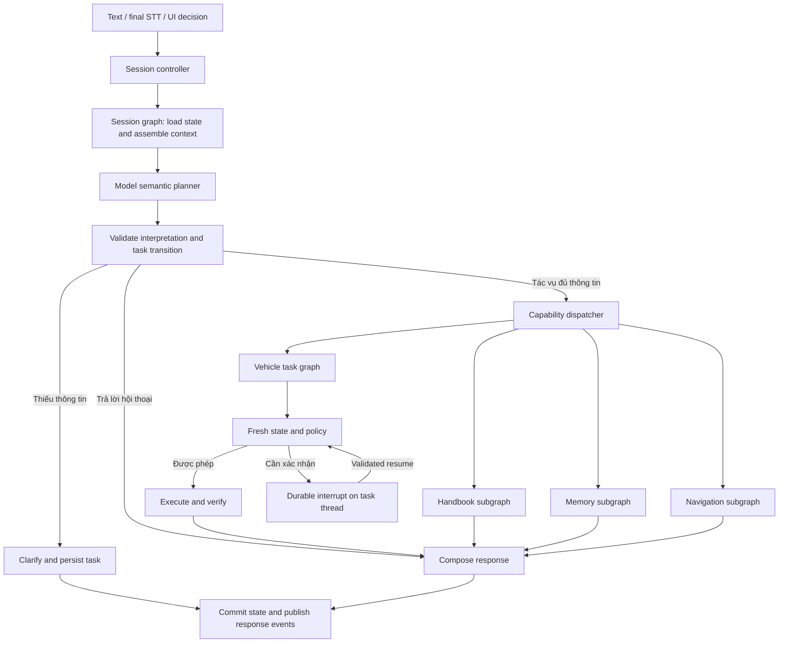

> Tài liệu lịch sử v2. Runtime hiện tại đã hợp nhất và xoá builder v1; xem [workflow thống nhất](../langgraph_unified_runtime.md).

> Tài liệu lịch sử. Runtime hiện tại và kết quả kiểm chứng mới nhất: [navigation_runtime.md](../navigation_runtime.md).

# Kế hoạch ViVi LangGraph v2

Ngày: 09/10/2026. Trạng thái: runtime v2 đã triển khai trong workspace; release gates API/voice/MQTT/canary còn chờ.

Xem [hành vi đã triển khai và giới hạn vận hành](langgraph_v2_runtime.md). Nội dung
bên dưới là kế hoạch gốc và tiêu chí đích, không phải tuyên bố mọi gate đã đạt.

## 1. Mục tiêu và bằng chứng

Chuyển ViVi sang kiến trúc dùng model để hiểu ngôn ngữ và quan hệ giữa các lượt;
LangGraph quản lý workflow/state; policy và gateway quyết định việc thực thi.
Ưu tiên hiểu đúng, giữ đủ ràng buộc, sửa được yêu cầu đang chờ và truy ra nguyên nhân lỗi.

Đã đọc code tại commit `e8a48b2` và history ở chế độ read-only:

- `data/vivi_rag.sqlite3`: bảng `handbook_turns`, 380 lượt tại thời điểm khảo sát.
- `data/2026-10-08/turns.jsonl`: 125 event, gồm 103 turn và 22 STT event.
- 90 lượt gần nhất trong SQLite có provider được ghi là Google ở 69 lượt,
  OpenAI ở 21 lượt. Trong số này, 19 lượt có `classify_intent_fallback` do HTTP 401.
- Provider được ghi hiện nay là cấu hình graph, không chứng minh model đã xử lý
  từng lượt. Confirmation/slot có thể bypass model; lỗi model có thể fallback rules.
- History có `conversation.search`, `search_location`, `zone_hint` không có trong
  contract của checkout hiện tại. Đây là bằng chứng lịch sử từ runtime khác phiên bản;
  cần replay trước khi kết luận lỗi còn tái hiện ở code hiện tại.
- Chưa có raw model decision trước/sau mọi override; chưa thể quy từng lỗi cho model
  hay rule cụ thể. Chưa có benchmark latency mới hoặc kết quả test pass của đợt khảo sát.

### Các ca bắt buộc đưa vào regression

| ID SQLite | Hội thoại/hiện tượng đã quan sát | Hành vi mục tiêu |
| --- | --- | --- |
| 742–762 | OpenAI 401, fallback rules; UI vẫn ghi provider OpenAI | Phân biệt requested/effective provider và degraded mode; không coi đây là đánh giá chất lượng OpenAI |
| 759–760 | “Mở cửa” → “Phía trước bên phải” mất pending slot | Gắn vị trí vào đúng tác vụ, giữ hành động mở, qua policy và confirmation |
| 768–769 | “Mở tất cả các cửa” → “chỉ cửa ra vào xe thôi” bị hỏi lại thao tác | Sửa phạm vi về cửa cabin, loại capo/cốp; vô hiệu xác nhận cũ |
| 798–799 | Đang chờ mở cửa bên phụ → “không, mở cửa kính bên đấy thôi” mất vị trí | Nhận diện correction, giữ referent bên phụ, đổi capability, xác nhận proposal mới |
| 800–802 | “bên ghế lái” bị hỏi lại hai lần, “bên tài” mới được hiểu | Cùng tham chiếu driver; không bắt buộc người dùng nói một keyword cụ thể |
| 802–805 | Chờ mở kính bên tài 100% → “mở 1 nửa thôi” hỏi lại zone | Giữ driver, đổi target 50%, tăng proposal revision, xác nhận mới |
| 806 | “hạ tất cả cửa kính xuống” tạo position_percent=0 và báo đã đóng | Hiểu là mở kính; chuẩn hóa rõ 0=đóng, 100=mở trong tool contract |
| 809–811 | “cột A ở đâu” hiểu thành địa điểm; câu nói rõ trên xe lại bị scope guard chặn | Định tuyến kiến thức xe; tìm bằng chứng, thiếu nguồn thì nói thiếu nguồn |
| 816 | “đóng tất cả cửa sổ trừ cửa ghế lái” thực thi zone=all | Giữ exclusion; thực thi đúng ba kính còn lại hoặc hỏi rõ nếu adapter chưa hỗ trợ |
| 818 | “tôi nóng quá tăng điều hoà lên tối đa” đặt 30°C | Nhận ra mâu thuẫn giữa mục đích làm mát và từ “tăng”; hỏi rõ nhiệt độ/quạt, không tự đặt 30°C |
| 813, 830 | Live search HTTP 429 trả answer rỗng | Lỗi capability phải có câu trả lời phù hợp; feature chưa khả dụng không hứa thực hiện |

Các nhãn mục tiêu là đề xuất sản phẩm cần review trong giai đoạn baseline. Dữ liệu
đã dùng để sửa prompt/code chỉ thuộc regression/dev; tạo tập holdout mới độc lập.
Chỉ đưa đoạn hội thoại cần thiết vào fixture, bỏ session ID và dữ liệu cá nhân.

## 2. Làm rõ các khái niệm

- `load_history` hiện đọc hội thoại để cung cấp ngữ cảnh và gọi `resume_task`.
  Nó phục vụ cả tham chiếu, follow-up và pending task, không chỉ pending.
- Intent classification là một bước hiểu yêu cầu. Orchestration quản lý toàn bộ lượt:
  context, model, tools, chờ input, safety, persistence, streaming và lỗi.
- Code đã gọi API: `StructuredAPIIntentClassifier`, Google/OpenAI/OpenRouter;
  local dùng native tools. `config.toml` chọn Google, nhưng env và UI có thể ghi đè.
- Chuỗi hiện tại có nhiều nơi hiểu ngôn ngữ: `resume_task`, memory handler,
  `memory_decision`, `input_guard`, classifier, authorization và context rewrite.
  Cần gom semantic interpretation vào một contract, có trace mọi biến đổi.

## 3. Kiến trúc đích



Session controller chịu trách nhiệm ordering, idempotency, cancel, deadlines và
transport. Planner hiểu ngôn ngữ, không trực tiếp gọi actuator. Capability graph
quản lý nghiệp vụ. Gateway/adapter là đường duy nhất thay đổi trạng thái xe.

Một planner call cho lượt thông thường: cùng lần gọi xác định dialogue act,
capability, tham số và quan hệ với task. Không bắt buộc một model riêng cho mỗi node.
Chỉ gọi bổ sung khi cần dữ liệu/tool result; giới hạn số bước và thời gian toàn lượt.

## 4. Planner dùng model làm đường chính

Thay `IntentDecision` phẳng bằng discriminated union `TurnInterpretation`:

- `dialogue_act`: request, answer_slot, confirm, deny, correct, cancel, question, chat.
- `task_relation`: new, continue, revise, cancel, suspend; task ID phải thuộc session.
- `capability` và arguments theo schema riêng của capability.
- `constraints`: tập đối tượng, exclusions, negation, điều kiện, thời điểm.
- `argument_sources`: current utterance / task revision / referenced turn / observation.
- `unresolved`: trường thiếu, tham chiếu mơ hồ, mục tiêu mâu thuẫn.
- `reply` chỉ cho hội thoại hoặc hỏi lại; tool result quyết định lời báo thành công.

Native tool calling hoặc structured output được adapter chuyển về cùng contract.
Validate schema, tool availability, enum/range, provenance và task ownership bằng code.
Provenance do model khai báo là dữ liệu cần kiểm tra, không tự chứng minh đúng ý người dùng.
Không dùng confidence tự khai của model như xác suất chính xác hoặc quyền thực thi.

Chuyển các rule hiểu ngôn ngữ tổng quát ra khỏi đường chính: bắt keyword theo topic,
rewrite câu hỏi ngầm, xóa zone vì parser không thấy keyword, memory handler ghi trước
khi planner chạy. Giữ rules cho contract/policy, transport và các tín hiệu dừng rõ ràng.
Xác nhận UI có ID được xử lý trực tiếp; xác nhận bằng lời tự nhiên cần interpretation
và kiểm tra có đúng task/revision đang được hỏi hay không.

Fallback có chính sách công khai: phân biệt auth/config 401, rate limit 429, timeout,
invalid output. 401 không retry vô ích; 429 tôn trọng backoff trong deadline.
Schema repair tối đa một lần nếu còn ngân sách. Provider dự phòng chỉ dùng nếu đã
cấu hình và đánh giá; nếu hết provider thì clarify/degraded response. Không tự chạy
một suy đoán điều khiển mơ hồ bằng rules. Offline rules là một profile rõ ràng.

## 5. State, memory và tác vụ nhiều lượt

| Thành phần | Dữ liệu và quyền sở hữu |
| --- | --- |
| Session checkpoint | Messages giới hạn, summary, referents, task references, session revision |
| Turn state | Input, interpretation, observations, evidence, results, errors; reset mỗi lượt |
| Task checkpoint | Task ID/revision, intent, known slots, missing slots, constraints, lifecycle, expiry |
| Confirmation/command ledger | Binding quyền xác nhận, execution key, dispatch/ACK/verification; lưu bền vững |
| Long-term memory | Sở thích/thông tin đã được yêu cầu lưu, theo profile; có provenance |
| Conversation history | Projection cho UI/audit/eval; không còn là nơi duy nhất quyết định task đang chờ |

Parent session graph dùng `thread_id` ổn định theo profile/session và checkpointer
lưu bền vững. Vehicle task cần interrupt dùng task thread riêng, có liên kết về session.
Session controller là nơi dispatch/resume task thread; không giữ root session bị
interrupt vô thời hạn, để người dùng vẫn sửa yêu cầu hoặc đổi chủ đề được.

Clarification thông thường lưu task rồi kết thúc lượt; lượt mới dùng input dict.
`Command(resume=...)` chỉ dùng cho đúng task thread đang interrupt. Không đọc lịch sử
văn bản để tái tạo quyền xác nhận. Không chuyển một câu “ok” cho task đã hết hạn.

Lifecycle: collecting → ready → awaiting_confirmation → executing → succeeded /
failed / unknown; có cancelled, expired, suspended. Pending proposal đổi tham số,
capability hoặc phạm vi phải tăng revision và thu hồi confirmation cũ.
Cho phép giữ một task hành động đang hoạt động cùng một số task tạm dừng có giới hạn;
khi quay lại phải kiểm tra expiry và context mới, không tự khôi phục quyền thực thi.

Khi đã checkpoint, reset các trường turn-local như action/evidence/errors để không
rò dữ liệu lượt cũ. Reducer chỉ dành cho dữ liệu cần merge; messages có trim/summary.
Client/model/service object đặt trong runtime dependencies, không serialize vào state.

SQLite dùng cho triển khai edge một process; storage port cho phép Postgres khi có
nhiều worker. Có schema version, migration, retention và recovery. Không hứa transaction
nguyên tử giữa checkpoint và actuator: dùng command ledger + reconciliation khi crash.

## 6. Capability và thực thi

- Tool registry là nguồn duy nhất cho prompt/schema, validator, availability và handler.
  Phân biệt unsupported capability với provider unavailable và insufficient evidence.
- Vehicle: fresh state → validate → policy → confirmation nếu cần → execute → verify.
  Sửa toàn bộ I/O đồng bộ đang chặn event loop; timeout/cancel không đảm bảo worker
  thread đã dừng, nên executor luôn kiểm tra quyền gửi lệnh ngay trước dispatch.
- Chuẩn hóa target selection: `zones: [...]`, có thể resolve `exclude_zones` thành tập
  hữu hạn. 0=closed, 100=open được mô tả nhất quán ở planner/adapter/UI.
- Nếu adapter chưa hỗ trợ tập zone thì từ chối có lý do hoặc thực thi kế hoạch tuần tự
  được policy cho phép; không làm tròn thành `all`. Mỗi step có idempotency key riêng.
- Lệnh nhiều bước chỉ chạy khi plan đã validate dependency, capability và quyền;
  read-only độc lập có thể song song, mutation tuần tự theo xe. Partial failure được
  báo theo từng bước; không giả định rollback được thay đổi vật lý.
- Ledger phân biệt proposed, dispatched, acknowledged, verified, unknown. Khi mất ACK
  không tự gửi command mới với ID khác; reconcile bằng ID/state theo adapter contract.
- Memory read/write/reset là node riêng; mọi đường reset áp dụng cùng policy.
  Preferences là context, không phải lời cho phép thực hiện action.
- Handbook: hiểu câu hỏi/canonical query → retrieval → evidence → generation → grounding.
  Không chặn kiến thức xe chỉ vì topic không nằm trong keyword dictionary. Chỉ nói
  thiếu bằng chứng khi đã đánh giá nguồn; giữ original utterance và provenance của rewrite.
- Navigation: nối API đã có vào capability graph, chọn địa điểm/đích qua task state.
  Live search/weather chỉ xuất hiện trong catalog nếu có adapter thật và health phù hợp;
  chức năng lịch sử không có trong checkout phải được inventory trước khi khôi phục.

## 7. Orchestration voice và telemetry

- Một lượt đang ghi state trên mỗi session; coordinator riêng theo vehicle ID để hai
  session không xung đột mutation. Multi-worker cần lease/fencing hoặc CAS bền vững.
- Request dedupe bằng session/turn ID và input fingerprint; cùng ID khác payload bị
  từ chối. Duplicate cùng payload trả trạng thái/kết quả đã có, không diễn giải lại.
- Event envelope: session_id, turn_id, task_id, sequence, type, timestamp.
  Events: accepted, thinking, clarification, confirmation_required, speech_segment,
  tool_status, final, cancelled, error. UI bỏ event cũ/duplicate theo thứ tự.
- Hỗ trợ ngắt lời: dừng playback tức thì, hủy planning chưa dispatch, tiếp tục reconcile
  lệnh đã gửi. Confirmation hết hiệu lực theo revision; disconnect không phải approve.
- Chat có thể stream câu sau khi đã chọn đường chat; action chỉ phát lời thành công
  sau verify; handbook chỉ phát nội dung qua grounding. Progress có delay threshold,
  tránh phát câu chờ cho mọi lượt nhanh.
- Trace theo từng node: outcome, latency, requested/effective provider, model, prompt
  version, build commit, decision source, semantic proposal, validated proposal,
  policy reason, retry/fallback, task transition, tool result và deadline còn lại.
- Trace không thu thập chain-of-thought. Nội dung log theo cấu hình retention/redaction.
  Chỉ phát event công khai được whitelist, không gửi toàn bộ checkpoint tới UI.
- Đo wall-clock end-to-end, planner time, first useful response, first audio, cancel
  latency, queue wait, tool verification latency, tokens/cost. Tách cold/warm và provider.

## 8. Các đợt triển khai và điều kiện hoàn thành

| Đợt | Công việc chính | Điều kiện hoàn thành |
| --- | --- | --- |
| 0 — Baseline | Replay log, điều tra test startup, inventory build/provider, gắn nhãn lỗi và trace decision source | Chạy được baseline; phân biệt lỗi STT/model/rule/context/tool; report không che lỗi |
| 1 — Contracts | State schemas, capability registry, lifecycle, events, policy contracts | Contract tests cho exclusions, corrections, availability, unsupported vs unavailable |
| 2 — Planner | Model semantic planner, context assembler, provider adapter, fallback policy | Replay các ca 759–760, 799, 803, 806, 816, 818 đúng; ghi before/after validation |
| 3 — Durable dialogue | Checkpointer, task threads, interrupt/resume, revision, migration | Restart/resume/cancel/expiry không mất task, không hồi sinh consent cũ |
| 4 — Execution | Async gateway, command ledger, vehicle coordinator, reconciliation | Duplicate/concurrent/crash/ACK-loss không gây gửi lệnh ngoài plan; unknown không báo thành công |
| 5 — Capability graphs | Vehicle, handbook, memory; navigation và live search theo catalog thực tế | Parity chức năng cũ, sửa scope “cột A”, mọi error có phản hồi; không side effect trong context loader |
| 6 — Voice | Event contract, speech scheduling, barge-in, bỏ kết quả lỗi thời | Ngắt tiếng nói, đổi lượt và xử lý command đã dispatch đúng lifecycle |
| 7 — Rollout | Shadow planner, feature flag, canary theo session, theo dõi và rollback | Đạt gate chất lượng/latency; migration và rollback được diễn tập |

Thứ tự phụ thuộc chính: 0 → 1 → 2 → 3 → 4 → 5 → 6 → 7.
Đợt 0 có thể bổ sung trace vào v1 để chẩn đoán trước khi thay toàn bộ graph.
Shadow chỉ chạy interpretation/read-only trên snapshot; chỉ một pipeline được phép
ghi memory hoặc gửi lệnh xe. Version workflow cố định trong một task đang dở;
rollback không đưa checkpoint v2 vào graph v1, task cũ được drain hoặc hủy có phản hồi.

## 9. Evaluation và release gate

Kế thừa các dataset voice/conversation/task/memory/RAG hiện có; không xóa report cũ.
Tạo `eval/dialogue_v2/` cho các episode có correction, exclusion, paraphrase, ASR noise,
topic switch, ambiguity, timeout, restart và concurrent turns. Tạo runner riêng cho
API-model eval, opt-in với budget; không gỡ network guard của runner offline hiện có.

Mỗi episode chấm route, dialogue act, exact arguments/constraints, task transition,
tool thực sự được gọi, final vehicle state, câu trả lời và số lần hỏi lại.
Tách interpretation score khỏi policy/execution score: `verified` chỉ chứng minh
xe đạt target được gửi, không chứng minh target đúng ý người dùng.

Gate đề xuất, cần chốt sau baseline trên môi trường triển khai:

- 100% ca regression trọng yếu về phủ định, exclusion, consent, revision, expiry,
  idempotency và error response đạt trên fixture/fault suite.
- Tập holdout mới: route macro-F1 ≥ 0,95; exact arguments + constraints ≥ 0,98 cho
  yêu cầu không mơ hồ; báo số mẫu và từng nhóm lỗi, không chỉ điểm tổng.
- Không có thao tác ngoài phạm vi trong tập kiểm thử bắt buộc. Kết quả hữu hạn này
  không phải bảo đảm xác suất lỗi bằng 0 ngoài thực tế.
- Episode completion và unnecessary clarification phải cải thiện so với v1 trên
  cùng bộ dữ liệu/model budget; chạy lặp để phát hiện biến động model.
- p95 ngắt playback mục tiêu ≤ 300 ms; p95 transcript-final → first useful audio
  cho lượt đơn giản mục tiêu ≤ 2,5 s trên profile phần cứng/mạng đã chốt.
  Đây là mục tiêu chưa đo; không tính filler là useful audio. RAG có ngân sách riêng.
- Mock CI luôn chạy offline; integration model API, MQTT và voice chạy suite riêng.
  Model selection dựa trên eval tiếng Việt/cost/latency, không mặc định model lớn hơn tốt hơn.

## 10. Bố cục mã đề xuất

```text
src/vivi/
  orchestration/   # session controller, event protocol, deadlines, cancellation
  graphs/         # session graph, task graph, capability subgraphs, typed state
  dialogue/       # model planner, context assembler, task lifecycle, contracts
  capabilities/   # registry and capability handlers
  providers/      # structured model adapter, retries, health, model metadata
  persistence/    # checkpoints, task/command ledger, history projection, migrations
  domain/         # deterministic policy and domain models
  vehicle/        # memory/MQTT adapters and execution gateway
  rag/            # retrieval/evidence/generation implementation
  speech/         # STT/TTS adapters
```

Di chuyển theo từng đợt, tránh đổi package chỉ để đổi tên. Khi thay `orchestration.py`
bằng package, giữ import/export compatibility trong đợt chuyển đổi. API v1 giữ adapter
cho response hiện có; event schema mới có version và frontend được chuyển cùng đợt.
README, contracts và ADR cập nhật theo hành vi đã triển khai, không dùng tài liệu cũ
để khẳng định provider runtime hiện tại.

## Tham khảo

- [LangGraph Graph API](https://docs.langchain.com/oss/python/langgraph/graph-api): state/node/edge, schema và reducer.
- [LangGraph persistence](https://docs.langchain.com/oss/python/langgraph/persistence): checkpointer theo thread và store cho dữ liệu dài hạn.
- [LangGraph interrupts](https://docs.langchain.com/oss/python/langgraph/interrupts): resume và việc chạy lại node chứa interrupt.

Repo hiện khai báo `langgraph>=1.2.11,<1.3.0`; khi triển khai phải kiểm tra phiên bản
được cài và pin bộ dependency đã kiểm thử. Không sao chép API mới trong docs nếu
phiên bản runtime chưa hỗ trợ. Interrupt không thay thế authorization, TTL hoặc
idempotency của side effect.
