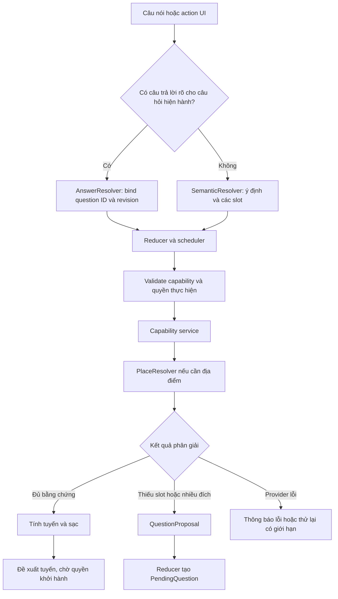

# Tổng quát hoá hội thoại và phân giải địa điểm

Trạng thái: đã triển khai nền tảng của các bước 1–5 trên runtime hiện tại ngày 14/10/2026. Bản dưới giữ thiết kế đã thống nhất; xem [contract và giới hạn triển khai](conversation_generalization_runtime.md) để phân biệt phần đã code với mục tiêu đánh giá tiếp theo.

## Điểm cần thay đổi

Code đã có nền tảng phù hợp: một LangGraph, `SemanticTurn`, reducer/scheduler, capability registry, NavigationService và ràng buộc handle/revision. Cần tổ chức lại phần hiểu câu nói và phân giải thực thể trên nền tảng đó.

Hiện còn ba nguồn tăng độ phức tạp:

- `OfflineParser`, `SemanticResolver`, reducer và NavigationWorkflow cùng diễn giải câu trả lời theo trạng thái. Thêm một phase thường phải sửa nhiều nơi.
- Đích đến chủ yếu là `query: str`. Tên, loại địa điểm, khu vực, yêu cầu gần nhất và thông tin người dùng vừa bổ sung chưa có một cấu trúc thống nhất đủ chi tiết.
- Search, lọc, quyết định chọn POI và dựng câu hỏi nằm trong workflow. Danh mục tên, quy tắc riêng như Vinhomes và ngưỡng khoảng cách giúp sửa log cụ thể nhưng chưa tạo được chính sách chung.

Mục tiêu là mỗi tầng có một đầu vào/đầu ra rõ, với quyết định có thể kiểm chứng trên địa điểm chưa xuất hiện trong test.

## Luồng đề xuất



Đây là các thành phần bên trong graph hiện tại. Không cần tạo graph hoặc agent riêng cho từng dạng câu nói.

## 1. Câu hỏi có hợp đồng, reducer sở hữu câu hỏi

Thêm hai kiểu vào dialogue contracts:

- `QuestionProposal`: capability đề nghị hỏi slot nào/chọn thực thể nào/xác nhận điều gì, cùng các lựa chọn và hiệu ứng tương ứng.
- `PendingQuestion`: reducer cấp ID và bind proposal vào task/step, owner, target ID, revision, thời hạn và trạng thái đang chờ.

Các purpose chung: `collect_slot`, `select_entity`, `confirm_proposal`, `approve_execution`. Ví dụ xác nhận POI là `confirm_proposal`; khởi hành là `approve_execution`. Câu “OK” được chuyển thành hiệu ứng của câu hỏi đang chờ, sau khi kiểm tra owner/revision/thời hạn. Nội dung tiếng Việt hiển thị không quyết định polarity.

`AnswerResolver` là nơi duy nhất xử lý lời đáp và action UI: yes/no, số thứ tự, handle, bổ sung slot, sửa yêu cầu, từ chối ứng viên. Nó chỉ nhận câu trả lời khi toàn bộ câu nói phù hợp với câu hỏi. Một yêu cầu mới đầy đủ hoặc câu mơ hồ được đưa qua SemanticResolver; không áp “OK” của thao tác cửa xe vào tuyến cũ.

Capability trả proposal; renderer dựng câu hỏi từ proposal; reducer quản lý câu hỏi và chuyển trạng thái. UI gửi question ID/option ID và target revision. Các typed action hiện có được giữ qua adapter trong giai đoạn chuyển đổi.

Checkpoint cũ `change_destination` cần adapter có nghĩa yes/no tường minh. Không thay nghĩa câu hỏi đã được người dùng nghe trước khi nâng cấp.

## 2. Đích đến là dữ liệu có cấu trúc

Đề xuất `DestinationSpec` trong navigation contracts, dùng chung cho navigation và trip:

```json
{
  "raw_text": "đền Trần",
  "name": "đền Trần",
  "entity_type": "temple",
  "area": {"text": "Nam Định", "source": "user", "constraint": "required"},
  "selection": "named_place",
  "qualifiers": [],
  "reference": null
}
```

Đây là ví dụ schema dự kiến. `entity_type`, `area` và `reference` có thể chưa biết. `selection` phân biệt named place, category/nearest, vùng rộng, hoặc tham chiếu địa điểm đã có.

Mỗi slot cần giữ nguồn: người dùng nói trực tiếp, câu trả lời của câu hỏi nào, ngữ cảnh của task hiện tại, vị trí xe, hoặc giả thuyết từ model. Khu vực người dùng yêu cầu là ràng buộc; GPS thường là ưu tiên tìm kiếm, không được tự loại đích xa.

“Nam Định” sau câu hỏi khu vực chỉ cập nhật `destination.area`. “Đến Hồ Tây” là yêu cầu mới thay destination. “Chỗ thứ hai” bind một handle trong tập ứng viên hiện tại. Không phải nối chuỗi và đoán lại ý nghĩa ở từng phase.

`query` hiện có là adapter sang DestinationSpec; query gửi nhà cung cấp được sinh ở PlaceResolver. Tên gốc có dấu được giữ để audit và tránh nhầm “đến” với “đèn”.

## 3. PlaceResolver dùng bằng chứng từ nhà cung cấp

Tách từ `NavigationWorkflow.search`, `selection.py` và các phần liên quan trong `destinations.py`:

1. **Lập query có giới hạn:** tên gốc, tên kèm khu vực, biến thể tên từ nguồn alias có bằng chứng. Giả thuyết tên do model đề xuất được đánh dấu chưa xác minh; không tự trở thành alias thật hoặc tọa độ.
2. **Thu thập và chuẩn hóa ứng viên:** ID nhà cung cấp, tên, địa chỉ, loại POI, hierarchy, tọa độ và nguồn. Thiếu metadata được giữ là unknown. Gom duplicate có bằng chứng; giữ riêng cơ sở, cổng và lối vào khác nhau.
3. **Đánh giá:** khớp tên/alias, loại thực thể, khu vực, chi nhánh/cổng, quan hệ địa điểm chính–địa điểm phụ, chất lượng metadata. Khoảng cách tới xe là một tín hiệu khi thích hợp. Ràng buộc rõ bị vi phạm thì loại; metadata thiếu không được coi là khớp.
4. **Ra quyết định:** mức bằng chứng của ứng viên tốt nhất và độ chênh với ứng viên tiếp theo. Ngưỡng được hiệu chỉnh bằng tập đánh giá; số confidence do LLM tự báo không đủ để chọn POI.

Đầu ra chung `PlaceResolution`:

| Kết quả | Hành động |
| --- | --- |
| `resolved` | Một thực thể có đủ bằng chứng; tiếp tục tính tuyến |
| `ambiguous` | Nhiều thực thể hợp lý; hỏi thuộc tính phân biệt như địa chỉ/cơ sở/cổng |
| `missing_constraints` | Hỏi đúng slot cần thêm, giữ DestinationSpec |
| `no_verified_match` | Nêu chưa có đích phù hợp; xin tên/địa chỉ khác hoặc thử biến thể còn trong budget |
| `provider_unavailable` | Báo lỗi bản đồ/thử lại; không coi là người dùng nói sai địa điểm |

`landmarks.json` và `regions.json` có thể tiếp tục cung cấp gợi ý alias/địa danh cũ, nhưng không quyết định địa điểm nào được hệ thống hỗ trợ. Địa điểm ngoài danh mục phải đi qua cùng pipeline. Alias thiếu bằng chứng cần hỏi người dùng; model và ranking không thể tự bù cho dữ liệu bản đồ không tồn tại.

Quan hệ venue–street–entrance–branch áp dụng chung khi có metadata đáng tin. Khi chỉ có tên và tọa độ, quan hệ suy đoán phải được ghi rõ; không biến “cách nhau dưới 200 m” thành bằng chứng hai địa điểm là một.

Chỉ tính tuyến/sạc khi đã có đích được phân giải, hoặc người dùng chọn ứng viên. Matrix có thể phục vụ yêu cầu gần nhất; không cần lấy tuyến tới mọi kết quả autocomplete. Kết quả tuyến và sạc tiếp tục dùng dữ liệu/map/equipment hiện có.

## 4. Phân chia việc của model và code

SemanticResolver hiểu câu tự nhiên thành `SemanticTurn` và slot có cấu trúc. Chưa hiểu ý định thì hỏi lại. RAG nhận yêu cầu kiến thức đã được phân loại; sự hiện diện của một từ như “đến/đèn” không đủ để chọn RAG.

Rules giữ các phản hồi ngắn, hành động UI và grammar offline có thể xác nhận đầy đủ. Chúng xuất cùng contract và cùng qua validation. Shortcut dựa trên độ đầy đủ của diễn giải/owner/slot, thay vì danh sách địa danh hoặc từng biến thể câu nói. Khi rules không đủ bằng chứng, dùng model hoặc hỏi lại trong chế độ offline.

Guard tập trung vào schema, nguồn slot, tham chiếu hợp lệ, phủ định/điều kiện/hẹn giờ và quyền thực hiện. Tránh duy trì hai bộ diễn giải đầy đủ rồi dùng regex viết lại mọi kết quả của model.

Nếu cần model hỗ trợ phân biệt ứng viên, cung cấp danh sách thực thể có ID và bằng chứng đã chuẩn hóa. Model không sở hữu task/revision, không tạo tọa độ và không cấp quyền khởi hành. Proposal và execution vẫn là hai bước riêng.

## 5. Độ trễ và khả năng vận hành

- Giới hạn tổng budget hiểu ý định theo turn, chia cho các provider thay vì chờ hết timeout dài ở từng provider. Mức 1,5–2,5 s có thể dùng làm mục tiêu ban đầu để đo và hiệu chỉnh, chưa phải cam kết trên model hiện tại.
- Câu trả lời của PendingQuestion và action UI hoàn toàn không cần model. Dữ liệu ngữ cảnh cho planner chứa slot/ID/tóm tắt, không copy geometry để tạo prompt.
- Search có tổng budget/số query hữu hạn; giữ kết quả thành công, hủy và drain tác vụ còn lại khi hết hạn. Cache có key gồm query, khu vực và ràng buộc phù hợp; không để query cũ quyết định đích mới.
- Phát tiến độ khi bản đồ/năng lượng còn đang tính. Log tách hiểu ý định, tìm ứng viên, phân giải, lấy tuyến, tính sạc, IO và tổng wall time. Giữ lý do chọn/hỏi lại để truy nguyên được lỗi.
- Provider không hoạt động thì mức dịch vụ giảm có kiểm soát: thao tác/slot rõ vẫn thực hiện được; câu mơ hồ hỏi lại. STT mơ hồ được giữ ở trạng thái cần làm rõ, không tự phê duyệt task cũ.

## Chuyển đổi theo thứ tự

| Bước | Thay đổi code | Điều kiện hoàn tất |
| --- | --- | --- |
| 1 | QuestionProposal/PendingQuestion, AnswerResolver, adapter legacy/UI | Voice/UI trả lời cùng câu hỏi tạo cùng hiệu ứng; owner/revision/expiry không sai |
| 2 | DestinationSpec và cập nhật slot trong reducer | Thêm khu vực, đổi đích, tham chiếu và round trip giữ đúng các bước còn lại |
| 3 | PlaceResolver, query planner, candidate evidence và resolution policy | Cùng chính sách xử lý tên mới, alias, category, branch/entrance và thiếu kết quả |
| 4 | SemanticResolver/OfflineParser dùng các contract chung; thu nhỏ guard | Bỏ các nhánh theo phase/tên/brand đã được thay thế; offline không hồi quy |
| 5 | Workflow nhận kết quả phân giải và dựng proposal; giữ service/locks/energy | Navigation và trip dùng chung resolver; không đổi cơ chế cấp quyền, chống stale và revalidation |

Các file đã tạo: `dialogue/questions.py`, `dialogue/answers.py`, `navigation/contracts.py`, `navigation/resolver.py`, `navigation/reads.py`. Legacy phase/query còn được đọc qua adapter để checkpoint và action cũ hoạt động; không tạo framework plugin mới.

Đối chiếu legacy và mới trên cùng fixture/candidate snapshot trước khi chuyển runtime. Migration có version và kiểm tra rollback; không chạy hai luồng thực thi xe hoặc gửi hai lượt tìm kiếm thật chỉ để so sánh.

## Bộ đánh giá phải kiểm chứng khả năng tổng quát

Giữ các regression từ log, bổ sung ma trận theo loại hành vi:

- Nhiều cách nói cùng ý định, tên POI chưa có trong danh mục, dấu tiếng Việt, câu nhiều thao tác và ngữ cảnh đang chờ khác.
- Named place, vùng rộng, địa chỉ cụ thể, category/nearest, đại từ tham chiếu, chi nhánh/cổng và đích ngoài vùng GPS.
- Thêm/sửa khu vực, đổi đích, sửa một bước trong chuỗi; UI và voice tương đương.
- Alias có/không có bằng chứng; tên trùng doanh nghiệp; metadata thiếu; provider trả rỗng/lỗi/chậm; STT mơ hồ.
- Handle cũ, question hết hạn, hai task cùng có offer, GPS/SOC thay đổi và điều khiển xe chen giữa lượt hội thoại.

Tách tập dùng hiệu chỉnh khỏi tập tên/cách nói mới dùng đánh giá. Có thể dùng property tests: thay tên và địa chỉ trong cùng cấu trúc vẫn phải giữ đúng transition; thêm ràng buộc khu vực không chọn POI ngoài vùng; xác nhận POI không cấp quyền khởi hành.

Đo riêng độ đúng intent, slot, entity; số câu hỏi làm rõ không cần thiết; tỷ lệ chọn sai đích; số lần gọi provider và p50/p95 latency. Regression count cao không tự chứng minh tổng quát nếu chỉ lặp lại những địa danh đã được vá.

Ngưỡng bằng chứng hiện là chính sách rules ban đầu, chưa được hiệu chỉnh bằng tập thực địa độc lập. Đánh giá entity accuracy và p50/p95 với provider/STT thật là công việc tiếp theo; không suy ra các chỉ số này từ số regression test.
