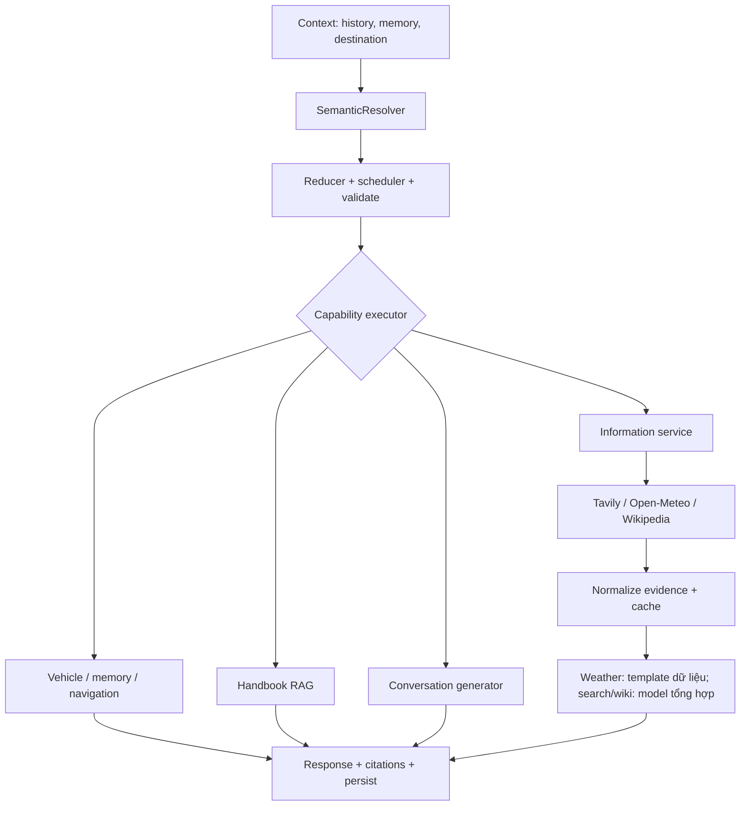

# Conversation và Information Service của ViVi

Cập nhật 12/10/2026. Phạm vi đã thu gọn còn ba nguồn: Tavily, Open-Meteo và Wikipedia; dùng VietMap hiện có cho bản đồ và dẫn đường.

## Luồng runtime



Model diễn giải đề xuất capability; code sở hữu tác vụ, xác nhận và execution. Thêm executor riêng cho conversation/information, không đi qua gateway xe.

## Tính năng

- `conversation.respond`: chat, kiến thức phổ thông ổn định, truyện ngắn giải trí khoảng 150–250 từ. “Kể tiếp” dùng tối đa sáu lượt history; chưa có quản lý truyện dài.
- `web.search`: du lịch, gợi ý nơi tham quan, thông tin mới và tra internet qua Tavily basic search. Không bật auto_parameters hoặc câu trả lời tự sinh của Tavily.
- `weather.get_forecast`: dự báo theo ngày hôm nay/ngày mai/ngày kia, gồm nhiệt độ min/max và xác suất mưa cao nhất ngày. Đây là dự báo ngày, chưa phải câu trả lời riêng từng giờ/buổi.
- `knowledge.lookup`: Wikipedia tiếng Việt, dự phòng tìm cùng query trên Wikipedia tiếng Anh; lấy phần giới thiệu bài và URL metadata.
- NavigationService cung cấp điểm đến cho “ở đó/nơi sắp đến”; hành trình đang chạy ưu tiên hơn tuyến thay thế chưa chấp nhận.
- Yêu cầu đi tới địa điểm có tên, ví dụ “Dẫn đường đến Tràng An”, đi qua capability navigation hiện có để lập tuyến/xác nhận.

Ví dụ: “Ở đó có gì chơi?” khi đang tới Ninh Bình → resolve thành câu hỏi Ninh Bình → Tavily → chọn nguồn → model gợi ý ngắn với bằng chứng → hiển thị liên kết nguồn. Search không tự tính khoảng cách tới tuyến hoặc tự bắt đầu dẫn đường.

## Tổng hợp và giới hạn nguồn

Adapter trả source ID, title, URL, excerpt, retrieved_at và published_at nếu nguồn có. Model chỉ trả text cùng source ID và quote hỗ trợ, không được trả action hoặc tự tạo citation URL. Backend kiểm tra ID tồn tại, quote xuất hiện trong excerpt và các số trong câu trả lời xuất hiện trong quote. Trạng thái `evidence_matched` thể hiện những kiểm tra này, không phải kiểm chứng ngữ nghĩa độc lập mọi khẳng định.

Không tìm được nguồn hoặc mọi generator lỗi/không cung cấp hỗ trợ hợp lệ thì trả lỗi có kiểu; giữ liên kết nguồn nếu có. Không lấy kiến thức model để thay thời tiết hoặc giá hiện tại. Thời tiết được dựng trực tiếp từ dữ liệu và đơn vị API, không dùng model sửa các con số.

Giá vàng dùng web search giới hạn nguồn SJC/DOJI/PNJ/BTMC. Chỉ chuyển sang tổng hợp khi excerpt có ngày hôm nay; prompt yêu cầu loại vàng, mua/bán, đơn vị và ngày báo giá. Chưa có adapter báo giá riêng hoặc đảm bảo dữ liệu giá luôn khả dụng; nguồn thiếu thì báo chưa xác minh và hiển thị liên kết.

## Cấu hình

Thêm vào `.env` của máy chạy:

```dotenv
TAVILY_API_KEY=your-key
```

Open-Meteo và Wikipedia không cần key. Shared defaults nằm trong `config.toml`:

- `conversation_enabled=true`, `information_enabled=true`.
- `tavily_monthly_limit=900`: tối đa 900 basic request mỗi tháng UTC trong ứng dụng, lưu bộ đếm tại `data/runtime/information-usage.sqlite3`. Request lỗi cũng được tính để tránh vượt mức; cache hit không tốn request. Bộ đếm này không theo dõi request từ ứng dụng khác dùng chung key.
- `information_max_results=5`, HTTP timeout 4 giây, deadline information 12 giây.
- `information_timezone=Asia/Ho_Chi_Minh`; geocoding có timezone thì weather dùng timezone địa điểm.

Demo/nghiên cứu dùng free tier: [Tavily](https://www.tavily.com/pricing), [Open-Meteo](https://open-meteo.com/en/pricing). Open-Meteo miễn phí giới hạn phi thương mại. Ứng dụng không đăng ký dịch vụ hoặc tự nâng gói khi hết quota.

Cache in-memory tối đa 128 entry: search 5 phút, weather 10 phút, Wikipedia 24 giờ, giá vàng 1 phút. Kiểm tra ngày dự báo khi lấy cache; restart xóa cache nhưng giữ quota. API không fetch arbitrary URL hoặc redirect từ kết quả search.

`offline_only` hoặc `rag_local_only` chặn mọi HTTP của Information Service ở executor; conversation vẫn dùng model local nếu đã cấu hình. Khi chọn rules và không có generator local, chat/kiến thức mở trả thông báo model chưa khả dụng, weather vẫn dùng dữ liệu API khi online.

## Hội thoại và API

Câu hỏi thông tin độc lập suspend tác vụ đang dở và vô hiệu consent cũ; lời chào giữ tác vụ nhưng không dispatch. “Tiếp tục” vẫn đi qua reducer và xác nhận mới khi cần. Chuỗi lệnh xe + câu hỏi thông tin giữ thứ tự và không phát lại bước xe nếu nguồn internet lỗi.

Checkpoint thêm `conversation_context` với default rỗng để giữ weather location/day qua restart. Không đổi namespace checkpoint hoặc xóa history/ledger. Trạng thái NavigationService giữ quyền sở hữu hành trình.

TurnResponse giữ route `conversation`; thêm `answer_kind`, `answer_basis` và metadata nguồn. UI hiển thị liên kết nguồn an toàn dưới câu trả lời, cho phép cuộn câu trả lời dài; TTS đọc text, không đọc URL. Citation được tổng hợp từ các bước trong lượt. NDJSON vẫn phát speech sau khi tạo/kiểm tra đáp án; barge-in giữ cơ chế hủy và loại kết quả turn cũ hiện có.

## Kiểm thử

`tests/test_open_world.py`: routing ngoài xe, Ninh Bình destination references, payload ba adapter, source support, cache/quota, offline policy, lỗi nguồn, cancellation, truyện dùng history, weather slot/restart/ngày tiếp theo và chuỗi xe + search lỗi.

`tests/test_frontend_information.cjs`: nguồn dưới dạng text/link an toàn và xóa nguồn cũ. Regression hiện có kiểm tra dialogue, consent, navigation, provider, API và barge-in.

Credential Tavily và model thật cần live smoke riêng sau cấu hình. Fixture tests không được tính là kiểm chứng chất lượng tổng hợp của model thật.

## Sửa lỗi từ log ngày 12/10/2026

Các lượt 12:52–12:55 UTC trong `data/2026-10-12/turns.jsonl` cho thấy Google HTTP 400,
local `ConnectError`, rồi parser dự phòng lấy “như nào nhỉ” và “Mình ở Hà Nội”
làm địa danh. Câu “lên lộ trình sạc và đi ninh bình” bị chuyển sang handbook.

Planner Google chuyển sang JSON mode với schema trong prompt, giữ kiểm tra
`SemanticTurn` và repair phía server. API thật đã nhận lại planner, trả lời chat
và dự báo Hà Nội thành công. Parser tách tên địa điểm khỏi người nói, ngày và đuôi
câu hỏi; không nhầm Hà Nội với động từ “hạ”; nhận grammar “lên lộ trình sạc và đi…”.
Guard giữ các slot hợp lệ từ model khi capability đã đúng. Thời tiết dùng GPS nếu
câu hỏi không có địa danh, ưu tiên thủ đô/thành phố cấp tỉnh giữa các nơi trùng
tên; vẫn hỏi lại nếu danh sách còn mơ hồ. Kiểm thử phát lại chuỗi log xác minh
bổ sung địa điểm hoàn tất cùng task và không tạo task treo mới.

## Tổng hợp search và kế hoạch sạc tuyến dài

Log 13:16 cho thấy planner Google lỗi JSON, nhưng search vẫn trả được nguồn.
Tổng hợp từng dùng `effective_provider=rules`, nên bỏ qua Google và chỉ thử local
đang mất kết nối. Capability trò chuyện/thông tin nay dùng provider người dùng
chọn, với bộ fallback và circuit breaker generation độc lập. Search được tổng
hợp thành một câu nói khoảng 30–60 từ; link giữ lại để tham khảo trên màn hình.
Kiểm tra source ID/quote/số liệu vẫn áp dụng, có một lượt repair trong cùng ngân
sách thời gian. Chỉ chuẩn hóa khoảng trắng khi so khớp quote; không bỏ kiểm tra
nội dung. Diagnostics phân biệt các lỗi quote, số liệu và schema.

Tuyến dài từng bị giới hạn 6 điểm khảo sát và 5 lượt ghé trạm. Thêm vào đó,
ưu tiên trạm dừng nghỉ thay các slot cuối bằng trạm ở đầu/giữa tuyến, làm mất
chuỗi trạm về đích. Hiện lấy tối đa 24 mẫu cách nhau khoảng 35 km, chia ứng viên
theo đoạn bất kể thứ tự API trả lời, và ưu tiên trạm nghỉ trong cùng đoạn.
Bộ giải giữ giới hạn frontier, cho phép đến 12 lượt ghé trạm mỗi chiều; kế hoạch
một chiều chỉ nối các trạm theo chiều tiến trên tuyến để giảm số hoán vị.
Chặng, pin và thời gian vẫn lấy từ đường bộ đã tính và profile/equipment hiện có.

Kiểm chứng bằng truy vấn du lịch Đà Nẵng công khai trả một câu có nguồn. API
VietMap thật với hai tọa độ công khai Hồ Gươm/trung tâm Đà Nẵng tính được tuyến
khoảng 744 km, 4 lần sạc, dự phòng ít nhất 15%; công suất sạc vẫn là giả định được
cấu hình, không phải phép đo trụ. Không gửi tọa độ trong log người dùng cho smoke
test này. Fixture tuyến 746 km kiểm tra không mất các trạm cuối tuyến do ưu tiên
trạm dừng nghỉ; regression bộ giải kiểm tra ghé 6 trạm trước chặng cuối đến đích.

Tham số focus/circle và giới hạn 10 gợi ý mỗi truy vấn đã đối chiếu
[tài liệu VietMap Autocomplete v4](https://maps.vietmap.vn/docs/map-api/autocomplete-version/autocomplete-v4/).
