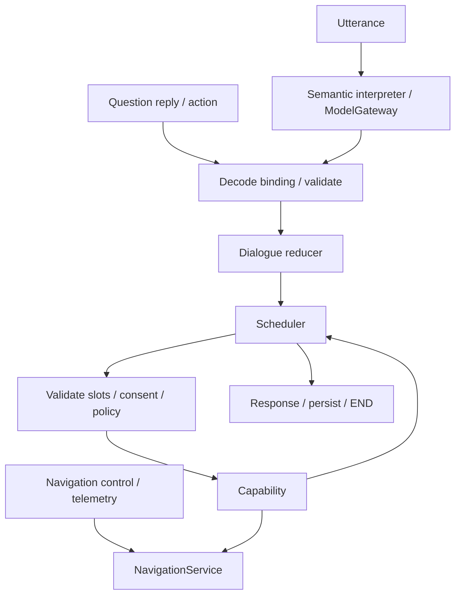

# Lõi hội thoại Core v2

Đây là tài liệu runtime hiện hành. Những bản `unified-*`, nhật ký theo ngày và tài liệu v1/v2 trước đây chỉ lưu quyết định lịch sử. API hội thoại/điều hướng dùng `/api/v2`; STT, TTS, memory, health và các API quản trị vẫn giữ `/api/v1`.

## Luồng và quyền sở hữu



Mỗi lượt vào từ entrypoint và kết thúc ở `END`. Không dùng interrupt chờ vô hạn để nối cuộc hội thoại. Chỉ có một graph; provider là chính sách gọi model của từng stage.

| Writer | Sở hữu | Lưu trữ |
|---|---|---|
| Dialogue | Task, bước, task tạm giữ, câu hỏi foreground, context gọn | Checkpoint namespace `conversation:4`, file `conversation-v4.sqlite3` |
| NavigationService | Một `PlanDraft`, một `ActiveJourney`, tiến trình và revision | `navigation_sessions` |
| Calculation repository | Geometry, legs, energy, alternatives bất biến | `navigation_routes`, aggregate giữ reference |
| Effect ledger | Command ID/payload, dispatch, receipt và trạng thái unknown | `command_ledger`, navigation event receipts |
| History/memory | Lịch sử tham khảo, thông tin ghi nhớ theo yêu cầu | SQLite riêng |
| Frontend | Snapshot đã commit và cache geometry | `NavigationStore` |

Domain navigation không import SessionState. Dialogue gửi domain command; không tự commit navigation quanh mỗi node. Dữ liệu `navigation`/`trip_plan` phục vụ adapter nội bộ là projection; không phải bản lưu state thứ hai và không có trong envelope API v2. Capability `trip.*` đã bỏ; dùng `navigation.*` và `purpose=itinerary`.

## LLM, fallback và budget

Câu tự nhiên, kể cả “có”, “không”, chọn số và tên địa điểm, đi qua semantic interpreter khi model khả dụng. UI gửi `question_reply` có binding sẽ decode trực tiếp. Model không cấp ID, revision, grant, tọa độ hay quyền thực thi.

`ModelGateway` dùng chung cho semantic, chọn ứng viên địa điểm, hội thoại và sinh câu trả lời handbook. Mặc định Google → local; chọn cloud khác thì cloud đó → local. Offline chỉ gọi local. Không có model provider `rules` trong catalogue/API mới. Nội dung trích xuất handbook có source riêng, policy và bằng chứng map không được ghi là model.

| Phạm vi | Budget mặc định |
|---|---:|
| Toàn lượt | 120 s |
| Semantic | 20 s |
| Mỗi provider | Tối đa 10 s, chia thời gian còn lại cho fallback |
| Đánh giá ứng viên địa điểm | Tối đa 3 s |

Repair schema tối đa một lần trong budget của provider. Hết thời gian hoặc lỗi transport/schema mới xét provider kế tiếp. `clarify`, `unsupported` và policy từ chối là kết quả hợp lệ. Validator có thể từ chối reference/slot thiếu chứng cứ; không chạy parser để sửa nghĩa model.

Khi không có model phục vụ được, `LimitedFallback` chỉ nhận **toàn câu** đồng ý/từ chối, số/handle của câu hỏi hiện hành, dừng hoặc hủy. “Đúng, bắt đầu luôn rồi bật nhạc” không được cắt lấy tiền tố. Câu khác giữ yêu cầu và câu hỏi đang chờ, báo chưa hiểu được. Không tính fallback thành model thành công.

Diagnostics ghi `semantic_source=llm|typed_event|fallback`, provider thực tế và từng stage/attempt với số lời gọi, repair, budget, thời gian, lý do fallback. Stage chọn địa điểm dùng provider yêu cầu, không dùng provider đã phục vụ semantic. Bằng chứng địa điểm rõ ràng và yêu cầu gần nhất có thể được quyết định bằng map evidence; LLM chỉ chọn handle có thật khi cần đánh giá.

## Draft, consent và hành trình

`purpose=navigate` tạo bước tính tuyến xem trước và bước start cần consent. Bước tiếp theo như nhạc chỉ chạy sau start thành công. `purpose=itinerary` hoàn tất sau tính kế hoạch; nhạc được chạy tiếp, khởi hành là hành động riêng.

Tạo tuyến mới thay draft, giữ journey đang chạy. Chọn POI, chấp nhận điểm đại diện và đồng ý khởi hành là những chuyển trạng thái riêng. Search không có POI hỏi khu vực và giữ tên gốc. Không tự lấy một chi nhánh/cổng có cùng tên làm đích.

Question được bind ở transition và lưu trong checkpoint; đọc state không tạo question mới. Binding gồm owner/target/revision, task/step, choices và expiry. Spoken semantic answer và nút UI cùng đi qua AnswerResolver. Reply cũ, hết hạn hoặc khác revision không được thực thi. Thay origin/đích/trip kind/pin/cơ sở tính toán thu hồi consent cũ; server hỏi lại nếu phải tính lại trước start.

Hai writer dialogue/navigation giữ lock riêng. Navigation thả writer khi chờ model/map, commit chỉ với generation/revision đã đọc. P có ưu tiên; kết quả read cũ không được ghi đè trạng thái mới. Telemetry không ghi checkpoint dialogue và không tăng revision draft. Telemetry cảnh báo nhu cầu cập nhật tuyến; không âm thầm thay draft/consent.

Command được checkpoint trước dispatch, dùng ID ổn định. Khôi phục đối chiếu effect ledger trước grant; effect chưa xác minh giữ `unknown`, không gửi lại vì mất response. Sau restart, hành trình mô phỏng do runtime sở hữu được park, không tự phát D.

## API và frontend

```json
{"session_id":"driver","turn_id":"unique-1","input":{"kind":"utterance","text":"dẫn đường đến Tràng An"},"provider":"google"}
```

```json
{"session_id":"driver","turn_id":"unique-2","input":{"kind":"question_reply","answer":{"question_id":"<ID server trả>","option_id":"yes"}}}
```

```json
{"session_id":"driver","turn_id":"unique-3","input":{"kind":"action","action":{"capability":"navigation.plan","arguments":{"query":"Tràng An","purpose":"itinerary"}}}}
```

POST `/api/v2/turn` hoặc `/api/v2/turn/stream`. Input là tagged union, không kết hợp field đoán loại input. Reply có đúng một `option_id` hoặc `value`. Envelope có `contract_version=2`, kết quả bước, `pending_question`, `navigation_workspace`, receipt và diagnostics. Cùng turn ID/payload được replay; payload khác cùng ID bị từ chối.

POST `/api/v2/navigation/events` dành cho control/telemetry có ID, revision, client sequence và epoch. GET `/api/v2/navigation/snapshot` dùng bootstrap/đối chiếu. NDJSON có một final chính thức; snapshot tạm `committed:false` không thay store. Store bỏ snapshot cũ, resync khi epoch đổi/thiếu geometry và cache route theo ID. Audio/event của lượt đã hủy không phát lại.

`create_app(runtime=..., runtime_factory=...)` cho phép inject dependency. Import route không khởi tạo runtime hoặc DB.

## Migration và rollback

Chỉ chạy một backend worker. Khi nâng cấp: dừng nhận lượt, đợi/đóng runtime cũ rồi khởi động bản mới. Migration schema 7 dùng SQLite backup API lưu ledger/history/memory/checkpoint hiện có dưới `data/runtime/backups/<timestamp>/` trước khi vô hiệu task, question/grant cũ và reset draft/journey. Checkpoint mới dùng namespace/file v4; history, memory và effect ledger vẫn giữ. Marker migration bảo đảm reset chỉ chạy một lần. Hành trình mô phỏng đang chạy được đánh dấu park; không tự replay lệnh xe.

Không phục hồi ledger cũ khi rollback: giữ ledger/receipt mới nhất và dùng revision ứng dụng đọc được schema hiện tại. Bản v1 trước cutover không phải bản rollback tương thích. DB của người dùng không được sửa trong quá trình chạy tests/eval.

## Kiểm chứng

```bash
make check
# Cần Mosquitto và mosquitto_passwd khi chủ động chạy MQTT:
bash scripts/check_local.sh --run-mqtt
.venv/bin/python -m eval.workflow_benchmark --repeats 3
.venv/bin/python -m eval.navigation_controls_benchmark --samples 100
# Có lời gọi model thật; không điều khiển xe/map:
.venv/bin/python -m eval.semantic_benchmark --provider google
```

Tests chia `tests/unit`, `tests/contract`, `tests/integration`, `tests/frontend`; dùng fixture chia sẻ độc lập trong `fixtures/` và `tests/support/`. Mặc định DB tạm, không đọc .env, chặn network ngoài loopback, model/map giả. MQTT/live/hardware phải bật riêng. CI chạy gate trước publish/deploy.

Các test v1/grammar bị thay contract và runner lịch sử được lưu ở `eval/legacy/`, có manifest truy nguyên. Chúng không được tính là pass Core v2 và số test trước/sau không thể so trực tiếp. Suite mới kiểm invariant qua vehicle state/receipt, không chỉ câu trả lời. Eval workflow cấp semantic có chủ đích và oracle độc lập; không chấm chất lượng hiểu câu. Semantic eval đọc dataset riêng và không tính fallback là thành công; dataset hiện là bộ phát triển, chưa phải held-out đã được người khác duyệt.

Latency P/D đo qua orchestrator, domain và SQLite/receipt, 100 mẫu **mỗi số** ở mỗi tải bình thường/model chờ/map chờ. Đo nhiều batch nhỏ trong deadline model/map thật; không tăng timeout để giữ dependency giả. Ngưỡng p95 theo từng số: 300 ms bình thường, 500 ms khi chờ. Kết quả không bao gồm HTTP/browser, VietMap/model thật, MQTT thực tế hay phần cứng Jetson. Live eval và nghiệm thu phần cứng phải chạy riêng trước công bố chất lượng sản phẩm.

## Evidence triển khai ngày 2026-10-15 UTC

Artifact ghi git revision nền và `working_tree_dirty=true`, dataset/fixture hash,
provider thực tế, attempts và môi trường. Các lần đo dưới đây chạy trên Linux/WSL,
Python 3.12; chưa phải nghiệm thu Jetson/xe thật.

- Gate `bash scripts/check_local.sh --run-mqtt` kiểm cả Python, JavaScript và broker Mosquitto cục bộ. Kết quả cụ thể cập nhật trong [acceptance](core_v2_acceptance.md).
- [Workflow](../eval/results/core-v2.json): 30/30 episode (10 scenario × 3), semantic/map/xe giả, SQLite/orchestrator thật.
- [Controls](../eval/results/controls-v2.json): 100 mẫu mỗi số/tải; p95 P/D bình thường 84,83/91,67 ms, model chờ 82,21/82,52 ms, map chờ 67,36/67,52 ms. Tất cả đạt ngưỡng 300/500 ms.
- Google thật `gemini-3.5-flash-lite`: [8 câu trước chỉnh](../eval/results/semantic-holdout-v2.json) đạt 7/8; [6 câu tiếp](../eval/results/semantic-holdout-after-fix-v2.json) đạt 4/6. Những ca đã dùng chỉnh prompt được giữ điểm cũ và chuyển thành development data.
- [6 câu mới sau cùng](../eval/results/semantic-dependencies-v2.json) đạt 5/6, không fallback. Ca `deps-new-5` vẫn chọn `navigate` thay cho `itinerary`. Đây là hạn chế semantic còn biết, không phải một test workflow đã pass. Bộ nhỏ, nhãn do người phát triển viết, chưa đủ công bố accuracy tổng quát.

Guard hiện yêu cầu làm rõ khi model bỏ `purpose` trong chuỗi navigation có bước
sau; scheduler giữ đúng dependency khi semantic phân loại đúng. Prompt nêu rõ
phải giữ cả bước phụ thuộc chưa được chạy. Các điểm live của các phiên bản prompt
khác nhau không được gộp thành một tỷ lệ chính xác.

Chưa kiểm VietMap thật, vehicle/hardware thật và Docker image. Docker trong distro
WSL này chưa được tích hợp; kiểm Docker dừng ở bước xác định daemon khả dụng.
Không chạy migration/deploy trên DB vận hành trong quá trình kiểm chứng này.
