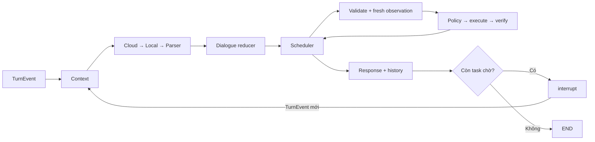

# Lõi hội thoại thống nhất (`unified-6`)

Trạng thái hành trình và receipt hiện thuộc NavigationService, nằm ngoài checkpoint hội thoại. Xem [contract, migration và kiểm chứng navigation](navigation_runtime.md).

ViVi dùng một workflow LangGraph có kiểm soát. Provider diễn giải toàn bộ lượt thành
`SemanticTurn`; code sở hữu task, revision, policy, grant và external effects.
Builder v1, shadow v1/v2, switch chọn graph và các classifier/keyword router cũ đã
được xoá. `agents/` còn DTO phản hồi, schema tham số và persona; không còn diễn giải.

## Contract và quyền sở hữu

- `dialogue/contracts.py`: act request/question/modify/confirm/deny/cancel/reply/
  clarify/unsupported/offer/suspend/resume, capability drafts, task handles và flags.
  Provider không tạo task ID, revision, route hay execution state. Tham số chưa rõ
  được để null. Schema JSON phẳng tương thích provider; validator từ registry từ
  chối trường không thuộc capability và yêu cầu sửa schema một lần.
- `dialogue/planner.py`: resolver, budget, circuit breaker, trace và prompt. Một
  kết quả clarification/unsupported hợp lệ kết thúc diễn giải, không fallback.
- `dialogue/parser.py`: normalization/lexer, grammar toàn câu, semantic frames và
  tham chiếu. Đây là tầng chứa keyword/synonym điều phối hội thoại duy nhất. Parser
  không ghi memory, không chạy capability. Câu chưa hiểu đủ phải hỏi lại.
- `dialogue/reducer.py`: tác giả duy nhất của task state. Cùng reducer cho model,
  parser và UI event; server bind “bên đó” từ checkpoint, từ chối side xung đột.
- `capabilities/registry.py`: catalog, schema, câu hỏi slot, compatible fields và
  validation. Đổi cửa sang kính chỉ chuyển zone/zones, không chuyển `open`.
- `capabilities/execution.py`: adapters vehicle/memory/handbook/navigation hiện có.
  Không diễn giải lại ngôn ngữ hay tìm provider khác để vượt policy.
- `graphs/assistant.py`: graph duy nhất, state tách `session` lâu dài và `turn` tạm.
  `graphs/__init__.py` phục vụ fixture/component tests; API và CLI dùng factory
  `create_langgraph_orchestrator`, cùng workflow và cấu hình fallback.

Thread `conversation:3:<hash(profile,session)>` độc lập provider. Checkpoint trong
`data/runtime/conversation-v3.sqlite3` giữ active task, tối đa ba task tạm dừng, slot,
steps, grant tham chiếu, kết quả và arguments đã resolve trước effect. Invocation
và streaming dùng `durability="sync"`, bảo đảm checkpoint hoàn tất trước khi bắt
đầu node thực thi; test đọc lại SQLite ngay tại thời điểm adapter sắp dispatch.
History là bản ghi/ngữ cảnh tham khảo; không dùng để dựng lại pending task. Long-term
memory chỉ ghi khi có yêu cầu lưu. Effect/turn ledger (`runtime/state.sqlite3`)
chống gửi trùng và đối chiếu kết quả; không sở hữu vòng đời task. Confirmation store
chỉ giữ grant có hạn, ràng buộc payload/command/profile và snapshot xe.

## Nhiều bước, xác nhận và restart

Tối đa năm bước theo thứ tự. Parser/model phải hiểu đủ toàn bộ câu trước khi tạo task.
Scheduler đọc trạng thái mới ở mỗi bước, validate và kiểm tra policy. Thiếu slot,
confirmation, blocked hoặc unknown đều dừng chuỗi, giữ các bước sau. Một grant chỉ
cho phép một bước; correction tăng revision và huỷ grant liên quan. Nói phủ định
khi đang chờ cũng vô hiệu grant; cancel chỉ huỷ phần chưa chạy, không hoàn tác.

Command ID là `task:<id>:r<revision>:step:<id>`. Arguments tương đối được resolve
bằng số đo mới và checkpoint trước khi dispatch; restart không tính delta lần nữa.
Ledger xác minh được effect thì reducer ghi completed; effect đã dispatch mà chưa
rõ kết quả không tự phát lại. Resume đi qua diễn giải/reducer, không tự cấp consent.
Task thông thường có hạn ba phút; khi chờ grant dùng hạn grant. Grant stale hay
snapshot xe thay đổi đều phải kiểm tra lại; không dùng số đo từ history.

API `steps` giữ kết quả từng phần. `action`/`execution` là bước hiện tại, không phải
consent cho cả chuỗi. Chỉ báo hoàn tất khi toàn bộ yêu cầu hoàn tất. NDJSON thêm
`provider` và `step`; success speech chỉ phát sau verify/grounding. Touch gửi typed
`action` qua cùng scheduler/policy. UI giữ owner/sequence/AbortController để loại
bỏ event và audio của lượt trước sau barge-in.

## Fallback và handbook offline

Cấu hình mặc định: cloud 10 s, local 12 s, toàn lượt 45 s, breaker 30 s. Thiếu config,
network/timeout/service failure hoặc schema lỗi sau một lần repair chuyển tầng.
Local chỉ có trong resolver khi đã cấu hình tên model. Có thể nối Qwen3 1.7B qua
endpoint hiện có; đợt này không tải/cài model. `rules` chọn parser trực tiếp.

Retrieval chạy local. E5 chưa có/lỗi thì dùng SQLite FTS, không cần AI server.
Model hiểu câu hỏi và đề xuất model/year được hỏi bằng trường có kiểu; retrieval
không lấy nguồn của phiên bản xe hiện tại để trả câu hỏi về phiên bản khác. Đường model không dùng heuristic sửa lại nghĩa câu hỏi. Retrieval
vẫn lọc metadata và phiên bản/bằng chứng; trích xuất offline chọn literal facts có
nguồn, giữ caveat/điều kiện trang bị. Citation URL/title lấy từ metadata local.
Không có bằng chứng đúng phiên bản hoặc grounding không đạt thì trả status có kiểu,
không rẽ nhánh bằng câu trả lời tiếng Việt. Generation lỗi chỉ fallback generator,
không diễn giải lại hoặc lặp bước xe đã thực hiện. Trace ghi riêng semantic tier và
generation tier; UI hiển thị provider thực tế.

## Migration và rollback

Factory chạy migration version 3 một lần trước khi nhận lượt. SQLite backup API
chụp ledger, history và memory đang tồn tại vào
`data/runtime/backups/<UTC timestamp>/`; tên có hash đường dẫn tránh trùng. Sau backup,
transaction vô hiệu task/suspended/grant legacy, giữ history/memory/effect ledger và
đánh dấu migration. Checkpoint dùng namespace/file mới, không tự resume checkpoint cũ.
Không cần xoá file checkpoint cũ để bật workflow mới.

Rollback bằng revision đã kiểm thử: dừng worker, chụp backup hiện tại, checkout
revision và cấu hình tương ứng, khôi phục DB phù hợp từ backup khi cần, vô hiệu pending
và grant trước khi nhận lượt. Nếu đã phát sinh effect sau migration, phải giữ/đối
chiếu ledger mới; không phục hồi ledger cũ làm mất dữ liệu chống gửi trùng. Không dùng
switch v1/v2 để rollback. Migration được kiểm thử trên DB tạm, không chạy thử bằng
cách xoá dữ liệu của workspace.

## Kiểm chứng và giới hạn

[Báo cáo regression](../eval/results/dialogue-unified-report.md) ghi đầy đủ API,
parser, cloud, memory, MQTT và smoke thoại. Các score là development regression,
không phải held-out accuracy hay bảo đảm hiểu mọi cách nói. Qwen dùng mock trước khi
server có model; smoke STT/TTS kiểm tra contract với mock transport. Chưa đo chất
lượng microphone/speaker hoặc xe thật. Deployment vẫn một backend worker; chưa
hỗ trợ nhiều worker dùng chung checkpoint/session lock.

Tham khảo: [LangGraph workflows](https://docs.langchain.com/oss/python/langgraph/workflows-agents), [persistence](https://docs.langchain.com/oss/python/langgraph/persistence).
