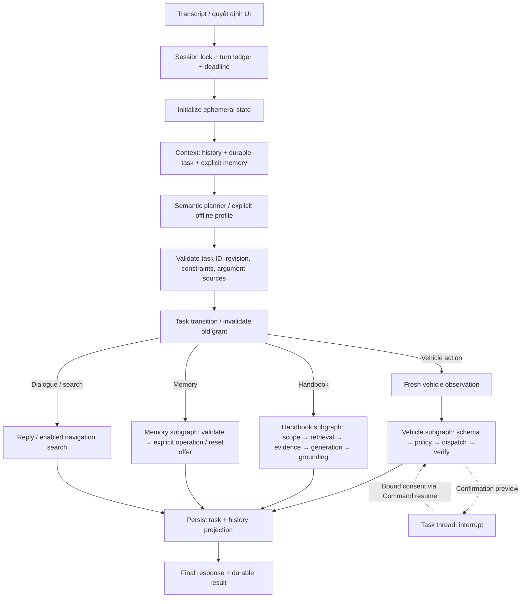

> Tài liệu lịch sử v2. Runtime hiện tại đã hợp nhất và xoá builder v1; xem [workflow thống nhất](langgraph_unified_runtime.md).

> Tài liệu lịch sử. Runtime hiện tại và kết quả kiểm chứng mới nhất: [navigation_runtime.md](navigation_runtime.md).

# ViVi LangGraph v2 — runtime và vận hành

Runtime mặc định dùng `graph_version = "v2"`. Semantic planner hiểu lượt nói bằng
model API; LangGraph điều phối state/task; policy và adapter sở hữu quyền thực thi.
`rules` là profile offline được chọn rõ ràng và còn hạn chế với paraphrase/correction.

## Workflow đã triển khai



Cloud/local semantic profiles gọi một `TurnInterpretation` có schema đóng, gồm
`dialogue_act`, `task_relation`, task ID/revision, decision, constraints, nguồn tham số
và unresolved slots. Các argument có nguồn `task` được đối chiếu với proposal đã lưu.
Validator không phải bộ chứng minh ngữ nghĩa: model vẫn có thể hiểu sai một câu hợp lệ.
Do đó quality phải đo bằng episode/holdout, không suy ra từ `verified`.

Không chạy regex classifier trước hoặc sau semantic planner. Giữ kiểm tra xác định
cho schema, task binding, exclusion, memory write intent và policy. Scope từ model
không bị regex unknown-topic chặn; các giới hạn scope rõ ràng vẫn được áp dụng.
Model API lỗi không tự fallback rules. Có circuit breaker 30 giây cho 401/403/429/502/503;
chỉ sửa output schema tối đa một lần, không retry lệnh xe.

`load_context` chỉ đọc. Memory writes nằm ở capability execution; xóa toàn bộ qua voice
cần xác nhận. Profile rules giữ parser memory legacy tại capability boundary.
Reset memory qua API quản trị vẫn là thao tác rõ ràng của người dùng.

## Task, checkpoint và external effects

- Session thread gắn profile/session/provider, dùng official SQLite checkpointer.
- Task là bản ghi có `task_id`, `revision`, expiry, proposal/follow-up và pointer tới
  checkpoint riêng. Một task đang active; tối đa ba task suspended có thể được tham chiếu.
- Correction tăng revision, vô hiệu grant cũ. Suspend bỏ grant và chuyển confirmation
  thành offer; resume tạo confirmation mới. Hết hạn không cấp quyền thực thi.
- Task confirmation dùng `interrupt()` và `Command(resume=...)`. Node chứa interrupt
  không gửi lệnh; policy/dispatch diễn ra sau khi gateway xác thực grant. Không resume
  checkpoint cũ để tự chạy lại một external effect.
- Grant SQLite single-use gắn action fingerprint/session/vehicle/version/expiry.
  Gateway kiểm tra lại policy và phiên bản trạng thái ngay trước dispatch;
  memory adapter kiểm tra version dưới lock, MQTT giữ expected_state_version trong command.
- Turn ledger từ chối payload khác dùng cùng ID; trả lại response đã hoàn tất khi replay.
  Command ledger ghi reservation trước khi gửi. Gián đoạn sau reservation có trạng thái
  `dispatched` hoặc `unknown`; không tự phát lại và không suy diễn “chưa gửi”.

Database tại `<data_dir>/runtime/state.sqlite3` và
`<data_dir>/runtime/checkpoints-<provider>.sqlite3`. History legacy chỉ là ngữ cảnh và
projection; đọc pending legacy một lần khi chưa có authoritative task record. Reset
monitor/history không đồng nghĩa xóa task, checkpoints hoặc memory.

Triển khai hiện tại dành cho **một backend worker** trên một thiết bị. Session lock
là asyncio lock trong process; SQLite dedup không thay thế distributed session lease.
Chưa hỗ trợ nhiều worker/cụm; cần shared checkpointer, lease/fencing và migration trước
khi scale. Memory simulator mất vehicle state khi restart; MQTT simulator có state
SQLite riêng. Không cam kết exactly-once vật lý với thiết bị ngoài repo.

Khi startup, turn `running` từ lần crash trước vẫn bị chặn replay. Dùng endpoint status
để đối chiếu ledger/observation. Observation trùng target không chứng minh lệnh đó là
nguyên nhân. Recovery hiện là read-only; không có nút tự gửi lại lệnh chưa rõ kết quả.
Checkpoint/ledger chưa có job retention tự động; backup và chính sách lưu trữ là gate
vận hành trước khi rollout dài ngày.

## Streaming và voice

NDJSON v2 giữ `progress`, `speech`, `final`, thêm version, session/turn ID, sequence và
timestamp. Speech chỉ phát sau output đã verify/grounding; có thể phát trước bước
persist, không stream lời model chưa kiểm chứng. Cached replay trả một final envelope.

UI cho phép bấm mic khi đang xử lý/phát tiếng, abort request cũ, dừng playback, gọi
cancel endpoint và bỏ event/audio từ owner cũ. Cancel trước dispatch ngăn gửi lệnh;
sau dispatch không thể thu hồi lệnh đã gửi, backend tiếp tục xác minh nếu client còn kết nối.
Nếu HTTP connection bị ngắt hoặc deadline cắt verification, dùng ledger status;
không khẳng định cancellation đã hoàn tác thao tác.

## API bổ sung

- `POST /api/v1/turns/{turn_id}/cancel`, body `{"session_id":"trip-01"}`:
  trả `{cancelled, dispatched}`. `cancelled=false` có nghĩa không thấy lượt active
  trong worker, không chứng minh chưa có command.
- `GET /api/v1/turns/{turn_id}?session_id=trip-01`: turn status, cached response,
  command status/result; thêm fresh observation khi kết quả command chưa rõ.
- Turn response thêm `execution` và `diagnostics`: workflow/prompt version,
  requested/effective provider, decision source, validated decision, node spans.
  `diagnostics.observation_available=false` nghĩa response không có snapshot xe mới;
  frontend giữ snapshot đang hiển thị thay vì dùng default compatibility state.
- Zoned tools nhận `zone` **hoặc** `zones`, không cả hai. `zones` là subset không trùng;
  hỗ trợ exclusion chính xác trong memory và service simulator.
- `navigation.search` chỉ có khi VietMap được cấu hình. Đây là tìm địa điểm;
  chọn đích/GPS/route tiếp tục qua journey API/UI hiện có. Không có live weather tool.

History/diagnostics có thể chứa hội thoại và decision; cần bảo vệ như dữ liệu cá nhân.
Task/checkpoint vẫn lưu dù tắt EventStore transcript logging.

## Cấu hình và rollback

```toml
graph_version = "v2"
llm_provider = "google"       # API key đặt trong .env
rag_local_only = false
planner_max_tokens = 2048
turn_timeout_seconds = 45
planner_shadow = false
```

Cài dependencies bằng `pip install -r requirements.txt`, restart backend để nạp code.
Chọn model/provider trong config hoặc UI. API từ chối provider không khởi tạo được;
health cho biết provider configured và khả dụng. Nếu provider mặc định không được
khởi tạo, API v2 không tự đổi sang rules; request không chỉ định provider cũng bị từ
chối. UI có thể hiển thị một provider khác đang khả dụng, cần kiểm tra lựa chọn trước khi đánh giá model. Không có runtime downgrade sau lỗi API khi provider đã chọn.

Shadow: `planner_shadow=true` dùng graph v1 làm executor; planner v2 chỉ bổ sung
`diagnostics.shadow`, không gửi tool call. Shadow chưa phải canary traffic router.
Rollback: đặt `VIVI_GRAPH_VERSION=v1`, `VIVI_PLANNER_SHADOW=false`, restart. Không xóa
DB v2; v1 không resume durable task threads v2. Yêu cầu người dùng tạo lại proposal
đang chờ sau khi đổi version. Quay lại v2 giữ DB; grant vẫn phải vượt TTL/version checks.

## Evaluation hiện tại

```bash
.venv/bin/python -m pytest -q tests/test_workflow_eval.py
.venv/bin/python -m eval.workflow_benchmark --repeats 3
.venv/bin/python -m eval.navigation_controls_benchmark --samples 100
```

Runner hiện tại dùng graph chung, SQLite/ledger thật và các dependency fixture có nhãn.
`eval/workflow_cases.jsonl` thay thế các dataset chia theo từng đợt sửa. Các scenario
kiểm tra receipt, trạng thái xe, draft/journey, restart, replay, provider timeout,
cancel và P khi model/map còn chờ. Profile model fixture kiểm tra contract và fallback,
không đo chất lượng model thật. Xem report (file sinh tại máy chạy: `../eval/results/report.md`; không lưu trong Git) và
[hướng dẫn](../eval/README.md) để biết kết quả revision hiện tại và giới hạn đo.

Phần v1/v2 còn lại trong tài liệu mô tả lịch sử migration; không dùng số pass cũ
làm điều kiện phát hành workflow hiện tại. Production, MQTT, STT/TTS và model thật
cần nghiệm thu riêng trên môi trường triển khai.

## Khi nào bỏ workflow v1?

V1/v2 là phiên bản workflow trong repo, không phải hai bản dependency LangGraph.
Hiện v2 gọi `agents.graph.build_graph()` để lấy capability subgraphs và preflight
policy helper. File này cũng chứa builder v1, nên xóa ngay sẽ làm v2 mất dependency.
Ngoài fallback config và shadow executor, CLI `ask` và các eval/test legacy còn gọi
builder này trực tiếp.

Thứ tự retirement:

1. Tách capability nodes/builders + policy preflight ra module dùng chung, để v2
   không khởi tạo hoặc import workflow v1. Giữ domain policy, grounding và schema.
2. Chuyển CLI/eval/test cần duy trì sang v2/capability API. Giữ các report v1 làm
   baseline dữ liệu; baseline không đòi hỏi giữ executor v1 trong runtime.
3. Chạy đủ regression API, fault tests (consent/revision/restart/cancel/idempotency),
   smoke MQTT và voice trên môi trường triển khai, đánh giá holdout mới. Smoke 3
   episode chỉ là kiểm tra kết nối/hành vi ban đầu, chưa đủ làm release gate.
4. Khi đã chấp nhận v2, bỏ v1 builder, graph_version switch và shadow executor v1;
   sửa docs/config. Rollback dùng revision/tag Git đã kiểm thử và backup DB, không
   để hai executor sống lâu dài. Có kế hoạch xử lý pending tasks khi đổi revision.

Không cần giữ v1 để “chờ LangGraph ổn định”; phần phải chờ là dependency extraction
và bằng chứng hành vi v2 trên workload thực. Việc retirement là thay đổi riêng để
review được, không xóa legacy giữa lúc đang kiểm thử model API.
