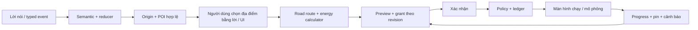

# ViVi: hội thoại, dẫn đường và năng lượng — 10/10/2026

Workflow `unified-5`, semantic prompt `semantic-unified-12`. Một LangGraph tiếp nhận
lời nói và sự kiện có kiểu, dùng chung reducer, scheduler, checkpoint và ledger.
Cloud → local → parser vẫn là fallback về khả dụng; câu hỏi làm rõ hoặc từ chối
hợp lệ không gây chuyển tầng. Xem [báo cáo nghiệm thu](../eval/results/navigation-update-report.md).

## Hội thoại

Context chứa task handle, bước hiện tại, slot thiếu/câu hỏi đang chờ, clarification
gốc, navigation handles và các bước hoàn tất. Model đề xuất semantic event;
registry/reducer quyết định chuyển nghĩa, revision và quyền thực thi. Tất cả xử lý
tiếng Việt nằm trong parser, gồm các kiểm tra bằng chứng áp dụng cho output model.
Đã bỏ classifier và executor demo không dùng trong trình duyệt.

- Giữ chuỗi điều hoà/nhạc qua lượt điền slot; giữ bản nháp khi một phần chưa hiểu.
- `trái` chưa có hàng ghế hỏi trước/sau; sửa từng phần và đổi cửa/kính giữ các
  slot tương thích. Không gán mặc định bên trái thành ghế tài.
- Task hết hạn sau 3 phút không tương tác; grant 30 giây độc lập. Xác nhận hết hạn
  không thực thi. Đồng ý bằng lời tạo đề nghị mới; UI yêu cầu grant mới.
- Offer có cấu trúc; câu trả lời thông thường không cấp quyền thao tác.
- Tên cần bằng chứng gán giá trị. `lưu/nhớ tên tôi` tiếp tục hỏi tên.
  `address_style` và `response_style` là hai sở thích riêng.
- Tăng/giảm nhiệt độ chưa có lượng thay đổi mặc định ±2°C; đặt/chỉnh thiếu
  nhiệt độ tuyệt đối vẫn hỏi. Câu trả lời nói mức thực tế trong giới hạn 16–30°C.

## Dẫn đường

Luồng trung tâm mặc định và kế hoạch khứ hồi độc lập đã được cập nhật trong
[kịch bản địa điểm/kế hoạch](navigation_dialogue_scenarios.md). `trip.plan` tính xong
vẫn để xe đứng yên, đề nghị bắt đầu gắn ID/revision riêng.



Các capability: `navigation.search`, `.plan`, `.select`, `.start`, `.stop`.
Search trả tối đa 3 ứng viên với tên/địa chỉ/quãng đường/thời gian và handle do
server cấp. Thành phố/khu vực phải chọn điểm cụ thể hoặc điểm đại diện trên map.
Kể cả chỉ có một ứng viên vẫn chờ lựa chọn trước khi mở map; đồng ý lúc này
chọn địa điểm, chưa khởi hành. GPS được lấy độc lập với map; câu hỏi chọn POI
sau khi lấy vị trí đi qua hàng đợi TTS chung. Search → climate → plan dùng
use_search_results=true, không tìm lại hoặc gộp mất bước. Chọn bằng lời/UI
cập nhật bước plan đang chờ, giữ IDs và các bước còn lại. Bắt đầu khi chưa chọn
không thay thế task.

Lời đọc địa điểm dùng tên ngắn và phường/xã, bỏ hậu tố thành phố; tên đầy đủ,
địa chỉ, khoảng cách và thời gian vẫn nằm trong dữ liệu bản đồ. Các chi nhánh
có cùng tên ngắn giữ thêm tên đường để phân biệt. Khi search và plan dùng lại
cùng danh sách handle trong một lượt, phản hồi chỉ đọc danh sách một lần.
Pin dự kiến được đọc theo phần trăm nguyên (làm tròn xuống), phút sạc làm tròn
lên và vẫn nói là ước tính. Không đọc nhãn mô phỏng của dữ liệu pin/sạc;
metadata, nguồn và số liệu tính đầy đủ được giữ trên giao diện. TTS đã phát
các đoạn trả lời streaming sẽ không đọc lại toàn bộ câu trả lời cuối lượt.
Lời nhắc đến nơi dùng `spoken_label` do server cung cấp; tên bản đồ vẫn đầy đủ.
Nhấn Bắt đầu trên tuyến đã xem trước chỉ hỏi xác nhận ngắn, không đọc lại
quãng đường/pin; grant mới vẫn gắn đúng revision và chưa cho xe chạy.

`pharmacy`/`charging`/`nearest` là tham số riêng, không gửi nguyên câu hội thoại
vào autocomplete. Không có vị trí thì hỏi; fallback GPS của UI được ghi rõ là
vị trí mô phỏng. Origin khai báo `lat`, `lng`, `label`, `simulated`, `observed_at`.

[Autocomplete v4](https://maps.vietmap.vn/docs/map-api/autocomplete-version/autocomplete-v4/)
dùng `focus` và category `cats` khi đã cấu hình mã được xác minh. Khi chưa có mã,
tìm bằng tên loại và kiểm tra danh tính POI tại tầng parser; đây là fallback
hạn chế, có thể bỏ sót POI không có tên loại. Chi tiết địa điểm phải có tọa độ hợp
lệ và road route. Kho logistics không trở thành hiệu thuốc.
[Matrix v4](https://maps.vietmap.vn/docs/map-api/matrix-version/matrix-v4/)
xếp hạng gần nhất theo đường lái; lỗi Matrix dùng Route cho tối đa 5 ứng viên.
Route adapter hiện có tiếp tục được giữ.

`NavigationState` là nguồn sự thật: origin, candidates, selected, route, energy,
alternatives, revision, event_sequence, progress, charging progress và pending.
Khi thay tuyến đang chạy, tuyến mới nằm trong `pending`; tuyến đang chạy được giữ
đến khi xác nhận. Huỷ đề xuất không hoàn tác hay thay tuyến đã chạy.
Grant gắn capability/arguments/command ID/route revision. Mở cửa/capo/cốp chặn
bắt đầu mô phỏng và giữ preview. Mỗi bước navigation start ghi ledger trước/sau
external effect; retry cùng turn không chạy lại.

## API và UI

Giữ `/api/v1/turn`, `/turn/stream`, `/confirmations/{id}`, `/turns/{id}/cancel`.
Response có `steps`, `navigation`, `ui_events`; streaming thêm `navigation` và
step/provider thực tế. History thêm `steps_json`, `navigation_json`, `errors_json`.
Tick mô phỏng không thêm bản ghi hội thoại; checkpoint/turn ledger vẫn chống replay.

UI chọn POI và lời nói cùng tạo capability event. Chạm bản đồ gửi `point`, không
tự tính tuyến. Frontend chạy animation, gửi khoảng cách/elapsed; backend tính SOC,
sạc và hoàn tất. Khi restart adapter mô phỏng, năng lượng của hành trình đã được xác nhận được khôi phục từ checkpoint; không phát lại lệnh khởi hành/MQTT. Trình duyệt không gửi giá trị pin để quyết định năng lượng/policy.
Revision, event sequence và state version chặn response cũ. Sau xác nhận mới
chuyển sang map thu nhỏ, hướng rẽ, ETA; ETA cộng thời gian dừng sạc ước tính.

Ví dụ typed progress:

```json
{
  "session_id": "driver",
  "turn_id": "unique-turn-id",
  "transcript": "Cập nhật hành trình",
  "navigation_event": {
    "kind": "progress", "id": "unique-event-id",
    "revision": 2, "distance_m": 1000
  }
}
```

Typed event kinds: `position`/`point` với `position`; `progress` với `distance_m`;
`charge` với `elapsed_s` trong 0–30 giây; `select_plan` với `plan_id` hiện có.
Schema lỗi trả HTTP 422; revision/handle cũ bị từ chối. Chọn phương án tạo preview
và grant mới. UI xác nhận qua endpoint confirmation, không ngầm approve tuyến.

## Dữ liệu năng lượng và bật tính sạc

Theo lựa chọn VF8 Plus gần đúng, mặc định nạp [hồ sơ mô phỏng](../data/energy/vf8-plus.json):
87,7 kWh, DC 149 kW theo VinFast; tiêu hao 22 kWh/100 km và đường cong sạc ước tính.
Tên/vị trí trạm được tìm trực tiếp từ VietMap dọc tuyến. File thông số trụ mặc
định rỗng. Xem [nguồn và cách ghép dữ liệu trụ](../data/energy/README.md).
Bộ tính cần hồ sơ khớp model/year. Chọn đúng edition/pin
bằng file hồ sơ, gồm dung lượng khả dụng, tiêu thụ, công suất xe, đường cong sạc,
connector, source và ngày cập nhật. Chưa có hồ sơ thì thông báo cần cấu hình,
không tính phút sạc. Dẫn đường thông thường vẫn có thể chạy mô phỏng.

```dotenv
ENERGY_PROFILE_PATH=data/energy/vf8-plus.json
CHARGING_STATIONS_PATH=data/energy/charging-stations.json
# Budget tìm trạm; bán kính shortlist; giới hạn quãng đường vòng
NAVIGATION_CHARGING_SEARCH_SECONDS=8
NAVIGATION_CHARGING_RADIUS_M=20000
NAVIGATION_CHARGING_MAX_DETOUR_M=15000
# Tuỳ chọn: mã loại đã xác minh từ tài liệu/tài khoản VietMap
NAVIGATION_PHARMACY_CATEGORY=
NAVIGATION_CHARGING_CATEGORY=
```

Kho trạm JSON list hoặc CSV có: id, name, lat, lng, network, connector, power_kw,
max_soc, accessible, source, updated_at, simulated. Mạng được dùng cho kế hoạch:
VinFast/V-Green. Công suất rỗng/đầu sạc không tương thích/không tiếp cận được loại
khỏi bộ tính; không suy công suất từ tên POI. Trụ từ 250 kW thuộc V-Green/VinFast
giới hạn 80% theo [chính sách V-Green](https://vgreen.net/vi/tram-sac-o-to-dien).

Discovery lấy tối đa 6 điểm dọc tuyến, tìm `trạm sạc` và `trạm dừng nghỉ` bằng
Autocomplete v4 `circle_center`/`circle_radius`, `layers=POI`. Hydrate tọa độ qua
Place v4, loại sai loại/ngoài hành lang, deduplicate ref_id. Tối đa 24 chi tiết
trạm sạc và 12 trạm dừng nghỉ; shortlist 8 trạm để kiểm tra road route. Tên trạm
dừng nghỉ được liên kết nếu có POI thật trong 300m; lời đọc nói “gần”, không
khẳng định cùng khuôn viên/cùng chiều. Tên đoạn đường lấy từ bước Route gần
projection của POI; progress là vị trí tương đối, không phải cột km chính thức.
Hai chặng origin→trạm→đích bắt buộc có Route; tổng vòng thêm mặc định ≤15km.
Trạm có connector đã biết không tương thích bị loại. Khi đủ pin không gọi
discovery. API lỗi không dùng trạm synthetic hay file để thay thế vị trí.

Thiếu công suất/connector trả `station_data_required`, hiển thị tối đa 3
`energy.station_candidates` với handle, nguồn, đoạn đường, quãng đường lái và
SOC đến. Ưu tiên trạm dừng nghỉ rồi điểm tiến xa hơn dọc tuyến mà vẫn tới được.
Chưa cấp grant cho toàn lộ trình sạc. Người dùng có thể chọn tới trạm bằng lời
hoặc UI; `.select` tính tuyến tới POI thật và vẫn yêu cầu xác nhận. Metadata trụ
ghép ref_id/tên + tọa độ duy nhất trong 100m, loại simulated. Các stop đã xác
nhận giữ thông số trụ trong checkpoint để tiếp tục sạc sau restart. Tuyến sạc
cũ dùng trạm synthetic/không có map ref phải tính lại trước khi khởi hành.

Bộ tính lấy tiêu thụ bảo thủ (hệ số mặc định 1.15), chỉ dùng cạnh road route đã
xác minh, duy trì SOC đến mỗi trạm/đích ≥15%, tối đa 5 trạm trong tìm kiếm. Kho
trạm được tìm từ bản đồ rồi kiểm tra đường lái; khoảng
cách thẳng chỉ dùng shortlist. Vì tìm kiếm có giới hạn, “không có phương án”
có nghĩa trong dữ liệu/tập ứng viên hiện tại, không khẳng định mọi trạm ngoài đó
đều không tới được. Routing không hoàn tất được gắn cờ riêng.

Tích phân từng khoảng SOC với công suất nhỏ nhất của trạm/xe/curve; cộng 5 phút
thao tác mỗi lần dừng. Trụ trống và thời gian chờ luôn ghi chưa biết. Tối đa 3
phương án: ít dừng, nhanh nhất, dự phòng cao. Ưu tiên ít dừng rồi tổng thời gian;
đánh dấu phương án tiết kiệm ≥20 phút. Model chỉ chọn ID + mã lý do từ phương án
khả thi; server dựng lời giải thích và giữ số liệu. Lỗi model dùng xếp hạng mặc
định, không chạy lại thao tác xe. Preview hiện từng trạm, SOC đến/rời, phút sạc,
tổng thời gian, provenance và các giả định.

[Hồ sơ synthetic](../examples/navigation/energy-profile.synthetic.json) và
[kho trạm synthetic](../examples/navigation/stations.synthetic.json) là ví dụ schema
để thử nghiệm, **không phải thông số VF8 hay trạm V-Green thật**. Không bật hai file
này trên hành trình thật. Fixture Hà Nội–Hải Phòng dùng road lengths tổng hợp
120 km, các chặng 50/70 km để đối chiếu tay: SOC 70% không dừng, SOC 40% dừng một
lần, SOC đến trạm 23.33%, sạc khoảng 10.4 phút, SOC tại đích 15%.

## Cảnh báo và âm thanh

Alert engine giữ LOW_BATTERY <20%, BATTERY_CRITICAL <10%, hysteresis +2 điểm.
Navigation tính lại dự phòng mỗi thay đổi ≥1 điểm SOC hoặc ≥1 km; route đổi được
tính ngay. Telemetry giảm ngoài dự báo được lấy từ adapter, không từ browser.
Pin đến chặng tiếp <15% tạo cảnh báo và pending phương án sạc có thể tới; phục
hồi ≥17% xoá cảnh báo. Không gọi model mỗi tick, không tự chuyển tuyến. Alert ID,
timestamp/cooldown 5 phút và mức độ nằm trong checkpoint; nghiêm trọng hơn được
phép báo ngay. Không có trạm phù hợp thì nói rõ giới hạn dữ liệu.

Điều phối TTS chung: cảnh báo nghiêm trọng ngắt audio cũ và tăng audio epoch;
đoạn hội thoại cũ không phát tiếp sau đó. Nhắc đường/cảnh báo thường xếp hàng,
không chồng TTS. Kiểm thử mới dùng DOM/map/audio mock, chưa đo loa/micro thật.

## Migration và nghiệm thu

Migration runtime version 4 sao lưu SQLite qua backup API trước khi đổi quyền
grant/task cũ. History/memory/command ledger được giữ; checkpoint v3 có trường
mới tương thích, reducer upgrade contract 8 và thu hồi grant không còn khớp.
Không tự execute task khi nạp checkpoint. Một backend worker như trước.

Bản ghi tên sai row 897 chỉ bị xoá khi profile/key/value/source_turn/revision
khớp đầy đủ. Repair tạo backup riêng; revision đã được người dùng sửa được giữ.
Backup đã tạo tại `data/memory/long_term-before-name-repair-20261009T144645564128.sqlite3`.
Không đổi greeting hiện có.

Rollback: dùng revision cũ đã kiểm thử và các backup DB đồng bộ, dừng worker trước
khi restore. Không phục hồi grant cũ vào workflow mới. Những thay đổi này chưa
restart hoặc deploy backend đang chạy.

Mốc 1 có regression core/44 lượt log/cloud fixture. Mốc 2 có HTTP stream/confirmation,
UI state và VietMap adapter. Mốc 3 có bộ tính và E2E **mô phỏng** đủ/thiếu pin,
nhiều trạm, restart/sạc/replay/cảnh báo. Lộ trình sạc thật chưa được nghiệm thu vì
chưa có hồ sơ xe và kho trạm thực đủ nguồn; Qwen thật, GPS, browser tile rendering,
microphone/speaker và xe vật lý vẫn cần kiểm thử trên thiết bị.
