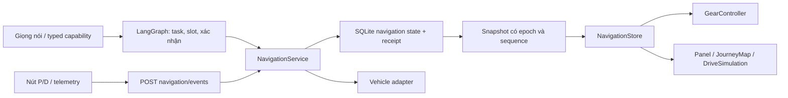

> Tài liệu lịch sử. Contract và vận hành hiện hành: [Lõi hội thoại Core v2](langgraph_core_v2.md).

# Navigation runtime và ổn định P/D — unified-6

Mốc triển khai: 2026-10-10 UTC. Phạm vi: web development, một backend worker, xe mô phỏng, giữ VietMap và cảnh 3D. Các báo cáo `navigation_controls_review.md` và `navigation_refactor_review.md` là lịch sử; số đo trong đó không dùng để nghiệm thu revision này.

## Quyền sở hữu và đường thực thi



- `graphs/assistant.py` giữ workflow hội thoại chung cho mọi provider. Checkpoint chứa task và `navigation_reference`, không chứa workspace/progress/receipt đầy đủ trong channel `session`. LangGraph vẫn dùng interrupt/resume và effect ledger.
- `navigation/service.py` là writer navigation duy nhất trong process: hydrate, recovery, revision fence, receipt và commit. HTTP typed event, voice capability và telemetry đi qua cùng service. Model/VietMap không nằm trong lock của P/D khi chờ mạng.
- `navigation/transitions.py` sửa trực tiếp journey đã nhận cho gear/pause/resume/end/clear/history. Các phép tính route/energy và progress/charge dùng workflow cũ làm adapter tính toán trên state tạm; kết quả chỉ service được commit. Đây là lớp tương thích có chủ đích, cần giữ cho đến khi các contract hội thoại cũ được thống nhất.
- `navigation/store.py` lưu `navigation_sessions`, `navigation_receipts`, `navigation_clients` trong SQLite runtime riêng khỏi các bảng checkpoint. Cache domain trong process là projection của store. Đảm bảo một worker; chưa hỗ trợ nhiều process cùng writer/cache.
- Frontend `navigation-store.js` nhận snapshot, đối chiếu epoch/sequence và cache geometry. `journey.js` giữ các cache/view model để tương thích, gọi các adapter mới `journey-map.js`, `journey-simulation.js`, `journey-renderer.js`. Chưa chuyển mọi hàm render sang lớp renderer.

## Contract P/D và API

`POST /api/v1/navigation/events`:

```json
{
  "session_id": "driver-session",
  "event": {
    "kind": "gear",
    "gear": "P",
    "id": "unique-event-id",
    "revision": 12,
    "client_id": "unique-browser-tab-id",
    "control_sequence": 2,
    "runtime_epoch": "epoch-from-snapshot",
    "expected_vehicle_version": 18,
    "expected_control_revision": 4
  },
  "known_routes": ["route:accepted-id"]
}
```

`id` là event ID hiện có, được trả ra bằng `event_id` trong receipt. `client_id` và `control_sequence` phải có cùng nhau. Client ID mới cho mỗi tab/page instance. Thứ tự đã nhận được lưu bền vững; replay cùng ID phải có cùng payload. Cùng ID với payload khác trả HTTP 409; timestamp observed_at mặc định của vị trí không tham gia identity chống replay, toạ độ và các tham số nghiệp vụ vẫn được đối chiếu.

Các event gắn với tuyến có thêm `target_id` và `revision`; client mới gửi target cho progress/charge/pause/resume/end. API cũ chưa gửi các trường mới vẫn được nhận trong giai đoạn tương thích, vì thế không bảo đảm sequencing xuyên reconnect cho client cũ.

Response gồm snapshot hiện tại và `receipt` của chính event. `control_receipts` chỉ là 32 receipt điều khiển gần nhất để trình bày. Receipt cũ vẫn truy vấn được bằng `GET /api/v1/navigation/snapshot?session_id=...&event_id=...`; việc chống replay không phụ thuộc danh sách 32 phần tử.

- P đóng băng chuyển động ở frontend ngay, được gửi song song với request D đang chờ. P ưu tiên các công việc đang xếp hàng ở backend; không thu hồi effect đã thực thi.
- Số hiển thị là số backend đã xác nhận. Khi đang chuyển hoặc đối chiếu, controller giữ ý định/pending riêng khỏi `confirmed`.
- Receipt D cũ không xoá pending P mới hơn. Response cũ bị chặn theo snapshot sequence. Không replay D khi timeout/restart.
- D tiếp tục journey paused; draft khác vẫn là draft. Không có journey hoạt động thì D vẫn là demo free-drive. Journey đã end không được hồi sinh bởi D.
- Backend chặn sequence cũ, epoch cũ, target cũ và D có control/vehicle version lỗi thời. Thay đổi revision/generation trong lúc tính tuyến chặn commit kết quả cũ. P không huỷ tra cẩm nang không liên quan.
- Mất response: đối chiếu receipt. Receipt `unknown` giữ chuyển động bị khoá; reservation lưu cả intent/gear trước dispatch, event chưa có kết quả không tự dispatch lại. Snapshot bootstrap có control_uncertain để tab mới vẫn khoá chuyển động; P xác nhận mới hơn giải quyết trạng thái không chắc chắn mà vẫn giữ receipt gốc để đối chiếu. Recovery đối chiếu durable receipt D kể cả unknown trước khi cho mô phỏng tiếp tục.
- Lỗi renderer/map không biến lệnh đã commit thành `unknown`: store/receipt được nhận trước, render được lập lịch riêng.
- Progress/charge không ghi checkpoint hội thoại; telemetry được gộp khi chờ. Một event charge hợp lệ tối đa 30 giây; batch charge vẫn giữ trần 30 giây của luồng tương thích hiện có. Client gửi tick ngắn đều, không dùng batch như phép cộng thời gian tuỳ ý.

`/api/v1/turn` và `/turn/stream` có `navigation_event` vẫn chuyển sang cùng domain và bỏ qua chọn model. Điểm đến/plan cần hội thoại tiếp tục dùng graph, không thêm một graph riêng.

## Recovery, migration và shutdown

Migration schema 6 chạy khi dựng runtime, trước khi phục vụ request. Nó tạo backup `backups/navigation-<UTC>/runtime.sqlite3` và `checkpoints.sqlite3`, lấy checkpoint mới nhất mỗi thread, chuyển domain state chưa có sang bảng mới, giữ history/ledger và invalidates grant navigation/trip cũ. Marker schema bảo đảm chạy một lần; domain row hiện có luôn thắng checkpoint cũ.

Journey đang running/charging phục hồi thành paused, giữ progress và resume status. Lần bootstrap đầu tiên đồng bộ simulator về P; free-drive có receipt D cũng được park khi khôi phục. Trạng thái xe ngoài domain không bị giả định là lệnh D của runtime. Không tự tiếp tục chuyển động.

Thao tác clear có revision marker để loại task navigation cũ ở lượt graph kế tiếp mà không cần telemetry viết checkpoint. Confirmation cũ không thể nhận lại tuyến đã xoá.

`Runtime.aclose()` ngừng nhận turn, cancel/await task graph và background, drain SQLite workers rồi mới đóng checkpointer/client. Effect đổi số đã dispatch được drain trước khi thả navigation writer, kể cả khi request bị cancel nhiều lần; P mới không bị thao tác D trong thread cũ vượt qua. Cả checkpoint và navigation repository có executor riêng theo thứ tự; coroutine bị huỷ không huỷ việc ghi SQLite đã chạy. `close()` đồng bộ còn giữ cho client cũ; server lifespan và fixture mới dùng `await aclose()`.

Khi áp dụng trên dữ liệu đang dùng: dừng process nhận request, bảo đảm một writer, khởi động revision mới rồi kiểm tra snapshot/receipt. Không chạy bản cũ cùng bản mới trên một data directory. Rollback bằng backup bộ runtime + checkpoint đã tạo và revision tương ứng; giữ bản DB mới để đối chiếu các receipt/effect phát sinh sau migration. Không phục hồi backup rồi tự gửi lại các effect chưa rõ. Đợt kiểm thử này chỉ dùng DB tạm, chưa migrate dữ liệu đang vận hành.

## Map và trace

Tên trong `data/navigation/regions.json` là danh mục alias, không cố định cấp hành chính. Khi tìm điểm đại diện, workflow xác minh tên với `boundaries` của VietMap; nếu lớp `CITY` không có kết quả đúng tên, thử thêm `WARD` một lần. Ví dụ “Nam Định” được tìm lại thành phường Nam Định thay vì nhận tỉnh Ninh Bình từ lớp `CITY`. Tiền tố người dùng nói rõ như “phường”, “xã”, “tỉnh” được giữ tại language boundary và xác định lớp tìm kiếm; không ghép khu vực cũ của câu hỏi trước vào tên hành chính mới. Kết quả trùng tên ở nhiều tỉnh/thành được đọc kèm tỉnh/thành để người dùng chọn. Kết quả POI hoặc tên chỉ khớp một phần không được dùng làm điểm đại diện. Xác nhận bắt đầu hành trình vẫn tách khỏi việc tìm địa điểm và xem trước tuyến.

Map config trả ngay, health probe chạy nền qua `/map-health`. SDK/style/tiles có lifecycle tải/lỗi/retry riêng; search không bị disable khi map lỗi. Retry/style reload dựng lại layers/markers từ snapshot mới nhất. `ResizeObserver` cập nhật kích thước; timer chỉ là fallback.

Geometry tuyến cache theo route ID (mỗi phép tính tạo ID mới) và được tham chiếu trong progress/charge response khi client đã có. Snapshot bootstrap đầy đủ để phục hồi cache. Không fit bounds khi chỉ thay đổi progress. Camera/marker tối đa 30 Hz, traveled geometry 5 Hz. Map ẩn ngừng cập nhật map, mô phỏng vẫn tiếp tục. Mobile dùng panel gọn, có nút Chi tiết/Thu gọn; mở chi tiết tự động khi cần chọn điểm. CSS tôn trọng hidden, padding fit bounds không vượt viewport và nút đóng không bị recenter che. Các geometry bên trong energy alternatives vẫn thuộc DTO tương thích; chưa tách toàn bộ geometry thành bảng riêng.

Client VietMap phía workflow tái sử dụng HTTP pool. Trace tách `navigation_search`, `navigation_place_detail`, `navigation_route`, `navigation_energy` theo lượt capability, bên cạnh queue/control và các node graph. Energy chỉ tính CPU planner; các span có thể lồng nhau, không cộng tổng latency bằng cách cộng mọi span.

`capabilities/result.py` chuẩn hoá status/data/effect_receipt/error_code/resource ở ranh giới capability, giữ trường cũ cho consumer tương thích. Stream có speech ID và sequence; frontend vẫn có một owner playback cho mỗi lượt. Capability mới phải khai báo schema, transition, failure/replay behavior và test xuyên boundary; không đặt quyết định nghiệp vụ trong map/renderer.

## Kiểm chứng và giới hạn nghiệm thu

Máy đo: Linux x86_64, Intel i5-11300H 3.10 GHz, khoảng 5,7 GiB RAM môi trường nhìn thấy, Python 3.12.12; Playwright 1.64.0, Chromium 156.0.8078.4 headless. Dependency runtime đã ghim tại `requirements-runtime.lock`; không thay lock Jetson.

| Phép đo | Mẫu | p95 |
| --- | ---: | ---: |
| Backend bình thường, gồm domain/receipt/turn ledger | 100 sau 5 warmup | 32,69 ms |
| Backend khi model đang chờ | 100 sau 5 warmup | 29,72 ms |
| Backend khi VietMap đang chờ | 100 sau 5 warmup | 24,94 ms |
| Click → DOM xác nhận, 1440×900 | 100 | 152,2 ms |
| Click → DOM xác nhận, 1024×768 | 100 | 197,1 ms |
| Click → DOM xác nhận, 390×844 | 100 | 201,7 ms |
| Click P → DOM đứng yên, ba kích thước | 50 mỗi kích thước | 5–6,3 ms |
| Frame, controller thật + tuyến 10.000 điểm | 301 | 16,8 ms |
| Tick navigation với tuyến 10.000 điểm | 301 | 0,4 ms |

Browser P/D dùng HTML/controller/API/SQLite/simulator thật và provider/VietMap fixture. Three.js và model 3D được khởi tạo; animation được tạm dừng trong phép đo control vì GPU phần mềm chạy quá chậm. Profile 10.000 điểm dùng DOM/controller thật nhưng SDK drawing fixture: không có long task >100 ms, camera/marker 112 cập nhật trong 5 giây, traveled paint 24, map ẩn có 0 cập nhật camera/marker. Các số frame/controller này không nghiệm thu GPU/VietMap hoặc cam kết steady state khi cảnh 3D chạy đầy đủ. Trong lượt stress có full regression, E2E video và map browser cùng chạy, backend p95 229–258 ms, click→ack DOM 249–362 ms; được lưu riêng để không lẫn tải bình thường với tải đo cạnh tranh.

Regression toàn repo sau các ca recovery/replan, trước bổ sung cuối về unknown bootstrap/cancellation drain: 662 passed, 13 skipped, 38 failed (337,99 giây). Kết quả cuối và danh sách đối chiếu nằm trong regression-summary.json. Cả 38 failure được tái hiện nguyên vẹn trên revision gốc caee730 trong checkout tạm. Chúng gồm khác biệt contract tự select/confirmation, thiếu navigation focus, projection pending và một số kịch bản destination/multi-action chưa đạt. Không sửa assertion để che lỗi. Regression navigation/domain/dialogue liên quan: 135 passed; frontend cuối: 67 passed. Regression navigation/P-D/lifecycle cuối: 85 passed (27,13 giây); hai ca bổ sung về cancel D nhiều lần và unknown bootstrap chạy lại: 2 passed. Ruff trên file Python sửa và git diff --check đều qua.

Layout: 1440×900, 1024×768, 390×844 và 390×568 qua kiểm tra hide/reopen, scroll, chọn thẻ, không xê dịch cảnh hoặc che điều khiển. Có trace và ảnh browser. Smoke VietMap thật đã qua tile HTTP 200, search 10 kết quả, place detail, route và SDK/style/tiles với 21 response HTTP 200, không page error; layer và ResizeObserver đều được xác nhận. Có ảnh mobile thật và video E2E fixture. Chưa nghiệm thu cold start p95 bằng mạng thật, video các lỗi UI thực địa và main-thread/GPU khi cảnh 3D đầy đủ. Không coi toàn bộ release gate đã xanh khi 38 contract test cũ còn thất bại.

Các script tái lập:

```bash
.venv/bin/python -m pytest -q tests
node --test tests/*.cjs
PYTHONPATH=. .venv/bin/python eval/navigation_controls_benchmark.py
VIETMAP_API_KEY= PYTHONPATH=. .venv/bin/python eval/navigation_control_server.py
# Ở terminal khác, với Playwright/Chromium được cài riêng:
node eval/navigation_control_browser.cjs
node eval/information_rail_browser.cjs
node eval/navigation_frame_browser.cjs
node eval/vietmap_map_browser.cjs # read-only live SDK, dùng cấu hình hiện có
```

Các fixture server chỉ mở DB tạm. Report/trace/ảnh mặc định nằm trong `/tmp/vivi-ui-check`; bản JSON và regression summary của lượt này được giữ ở `eval/artifacts/navigation-runtime/`.

Trước release: giải quyết 38 regression/contract test hội thoại tồn tại sẵn, nghiệm thu VietMap cùng GPU/3D trên browser máy phát triển, kiểm tra cold start/reconnect với dịch vụ thật. Việc tách nốt DTO tính toán phẳng và chuyển nốt render là cải tổ tiếp theo sau khi các gate này đạt.

Cập nhật 11/10: [chọn đề xuất và timeout Sầm Sơn](navigation_followups_oct11.md), gồm sửa ordinal/handle, batch VietMap, thu gọn checkpoint và phục hồi kế hoạch sau timeout.

Artifact lưu lâu dài: [regression summary](../eval/artifacts/navigation-runtime/regression-summary.json), [số đo backend](../eval/artifacts/navigation-runtime/navigation-backend-performance.json), [số đo UI](../eval/artifacts/navigation-runtime/navigation-performance.json), [map VietMap mobile](../eval/artifacts/navigation-runtime/vietmap-live-390.png). Trace và video lớn giữ ở `/tmp/vivi-ui-check/navigation-*-trace.zip` và `/tmp/vivi-ui-check/videos/`.
