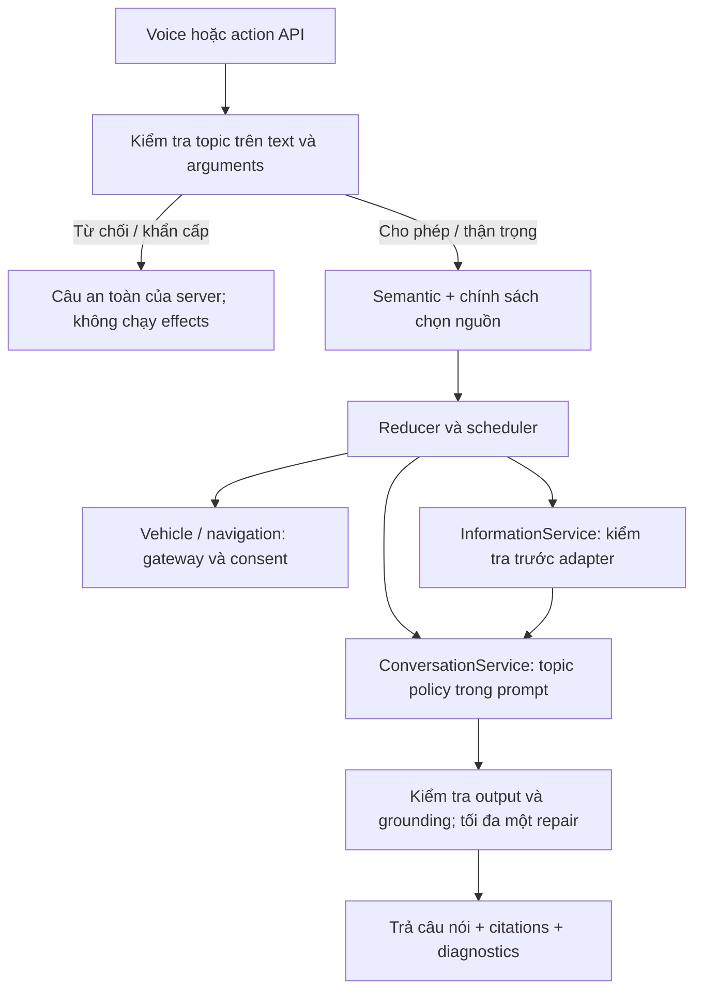

# Chủ đề conversation và guardrails — topics-1

Vivi hỗ trợ câu hỏi mở. Policy xét **ý định và mức rủi ro**, không dùng danh sách
chủ đề được phép để từ chối toàn bộ sức khỏe, chính trị hoặc tài chính.
Chính sách chủ đề và chính sách chọn nguồn là hai quyết định riêng.

| Nhóm câu hỏi | Ví dụ | Cách xử lý |
| --- | --- | --- |
| Trò chuyện, cảm xúc, sáng tác | Tôi buồn; kể chuyện vui | Conversation; thân thiện, không suy ra thao tác xe |
| Kiến thức ổn định | Vì sao có cầu vồng? | Model knowledge; có thể dùng Wikipedia khi cần kiểm chứng |
| Thông tin thay đổi | Thời tiết, giá vàng, giờ mở cửa, mức phạt, lãi suất | API/web; tổng hợp có nguồn, không lấy dữ kiện hiện hành từ trí nhớ model |
| Du lịch và địa điểm | Ninh Bình có gì chơi? | Web cho gợi ý; yêu cầu dẫn đường chuyển NavigationService, cần phân giải địa điểm |
| Xe và handbook | Pin còn bao nhiêu; VF8 sạc AC bao lâu? | Dữ liệu xe/RAG; effects qua gateway, consent và safety hiện hữu |
| Sức khỏe | Paracetamol có tác dụng gì? | Thông tin chung; không chẩn đoán chắc chắn hoặc chọn liều riêng cho người dùng |
| Pháp luật | Hợp đồng lao động; mức phạt giao thông | Giải thích chung; quy định hiện hành cần nguồn, xét nơi/thời điểm, không bảo đảm kết quả pháp lý |
| Tài chính | Rủi ro cổ phiếu; giá vàng | Giải thích và rủi ro, giá cần nguồn; không hứa lợi nhuận hoặc chỉ đạo đầu tư cá nhân |
| Khẩn cấp | Tôi khó thở; tôi muốn tự tử; xe đang cháy | Câu hỗ trợ an toàn trực tiếp, hướng tới trợ giúp địa phương; không đợi search hoặc tự thực hiện action |
| Riêng tư và bảo mật | API key trong câu; tìm nhà riêng người khác | Chặn secret rõ ràng trước model/search; từ chối xâm phạm riêng tư, đề xuất kênh công khai |
| Yêu cầu gây hại | Làm bom; phishing; vô hiệu hóa phanh | Từ chối hướng dẫn thực hiện, có thể giải thích phòng tránh |
| Tình dục và thù ghét | Nội dung tình dục trẻ em; kích động bạo lực | Từ chối; kiến thức sức khỏe sinh sản, bảo vệ trẻ em và trao đổi quan điểm tôn trọng vẫn được phép |

## Contract và các điểm kiểm soát

`conversation/guardrails.py` sở hữu `TopicDecision`:

- `topic`, `handling`: `allow`, `caution`, `refuse`, `urgent`.
- `reason`, `version`: mã server phục vụ diagnostics và đánh giá.
- `message`: câu server cho tình huống rõ ràng cần kết thúc sớm.

`caution` thường vẫn tiếp tục trả lời. Yêu cầu chọn liều/chẩn đoán cá nhân rõ ràng
có phản hồi giới hạn cố định. `refuse` trả `blocked`; `urgent` trả `answered` với
`answer_basis=policy`. Không gọi model/search cho những nhánh kết thúc sớm.

1. `AssistantGraph.interpret` kiểm tra input trước resolver và kiểm tra lại các
   draft trước reducer. Một yêu cầu nguy hiểm trong câu ghép chặn **cả lượt**,
   tránh thực hiện bước mở cốp trước khi từ chối phần còn lại. API typed action và
   question reply cũng đi qua cùng boundary. Tasks đang có được giữ, lượt bị chặn
   không cấp consent. Telemetry/control events vẫn dùng domain runtime hiện hữu.
2. `ConversationService.respond` và `InformationService.execute` tự kiểm tra để
   bảo vệ cả những caller không đi qua graph. Information kiểm tra cả query sau
   phân giải tham chiếu, trước network, cache và quota. Dịch vụ search không nhận
   toàn bộ memory/history; câu ghép dùng query của riêng step.
3. Semantic model và answer model cùng nhận `TOPIC_INSTRUCTION`. Nguồn web,
   history, creative mode và roleplay không có quyền thay policy hoặc gateway.
4. Output guard phát hiện một số mẫu rủi ro rõ ràng: secret, khẳng định chẩn đoán,
   chỉ định liều, hứa lợi nhuận/kết quả pháp lý. Tận dụng một repair đã có trong
   generation budget; thất bại trả `topic_output_violation`, không đọc ra bản
   trả lời bị chặn hoặc hiển thị lại citations của bản đó. Đây là lớp bổ sung cho
   kiểm tra source IDs, quote và số liệu hiện hữu.

Diagnostics `topic_guardrail={version,topic,handling,reason}` không chứa secret
hay bản sao câu bị chặn. Nhánh từ chối/khẩn cấp giữ `error_code=topic_<reason>`.
Output violation không kích hoạt lượt search nâng cấp, tránh dùng thêm nguồn để
vượt giới hạn an toàn. Nhánh bình thường không thêm lượt gọi model, chỉ có kiểm
tra local; nhánh rõ ràng bị chặn bỏ luôn chi phí planner/search.

## Giới hạn và kiểm chứng

Đây là policy ban đầu, gồm fast path theo mẫu rõ ràng và hướng dẫn semantic cho
LLM. **Không phải bộ phân loại semantic đầy đủ**, không chứng minh mọi câu trả
lời an toàn hoặc được nguồn suy ra chính xác. Tiếng lóng, đa ngôn ngữ, phủ định,
câu ghép và cách diễn đạt mới cần bổ sung eval. Không có cam kết phát hiện mọi
PII hoặc tự ẩn toàn bộ dữ liệu trong transcript/log/history; bảo vệ lưu trữ,
retention và kiểm soát truy cập là yêu cầu riêng. Không suy vị trí khẩn cấp từ
Hà Nội mặc định của weather, không tự gọi cấp cứu, không bịa số hotline.

`tests/test_topic_guardrails.py` kiểm tra cả câu an toàn dễ chặn nhầm, câu rủi ro,
roleplay, bypass API, câu ghép với thao tác xe, khẩn cấp, không gửi network/ghi
quota, output không an toàn và giới hạn repair. Các adapter/model dùng mock:
đây là kiểm chứng contract runtime, chưa phải đánh giá mức tuân thủ của model
Google/local thật. Trước khi mở rộng phạm vi sử dụng, cần đánh giá các model
được cấu hình bằng tập câu tiếng Việt có nhãn, theo dõi cả lọt câu nguy hiểm và
chặn nhầm câu an toàn. Policy phải được cập nhật tập trung tại module này.

Kiểm chứng ngày 14/10/2026:

- Chạy toàn bộ 1.105 kiểm thử: 1.103 qua; hai kiểm thử RAG/voice vẫn kỳ vọng
  `unsupported` cho can thiệp túi khí/điện cao áp. Hành vi thực tế đã chặn đúng,
  không có action. Đã cập nhật hai kỳ vọng sang `blocked` và kiểm tra reason code.
- Sau cập nhật, chạy lại toàn bộ nhóm guardrails, RAG, voice, history và
  conversation generalization: **232 passed**, gồm cả hai kiểm thử trên. Không
  thay đổi production code sau lượt chạy đầy đủ này.
- Ruff, `git diff --check`, syntax `app.js` và frontend information test đều qua.
- Script `check_local.sh` còn kiểm tra whitespace của commit HEAD; giới hạn ở
  commit cũ được ghi trong [information review](information_review_2026-10-14.md).
  Kết quả trên không có nghĩa bước kiểm tra commit HEAD đã qua.
